# Artikin — Architecture

> **Living document.** Every agent updates the sections of its area whenever structure, data model,
> APIs or significant decisions change, and adds an ADR (§17) for notable decisions.
> Product requirements live in [PROJECT.md](./PROJECT.md); status and handoff in [PROGRESS.md](./PROGRESS.md).

| | |
|---|---|
| Last updated | 2026-11-27 — Supervisor (architecture diagrams redrawn for the final implementation: §1, §3, §4, §5, §7, §9, §9.11, §11, §16.2; §16.2 live deployment) |
| Implementation status | **v1 complete** — gates G1–G5 accepted; **v1.1 "import your own model"** — gate G6 accepted. All sections describe the implemented system. **Live at <https://artikin.vercel.app>** since 2026-11-27 (§16.2) |
| Diagrams as files | PNG, SVG and Mermaid source of every diagram below in [diagrams/](./diagrams/README.md) — regenerate with `scripts/render-diagrams.mjs` after changing a diagram here |

---

## 1. System overview

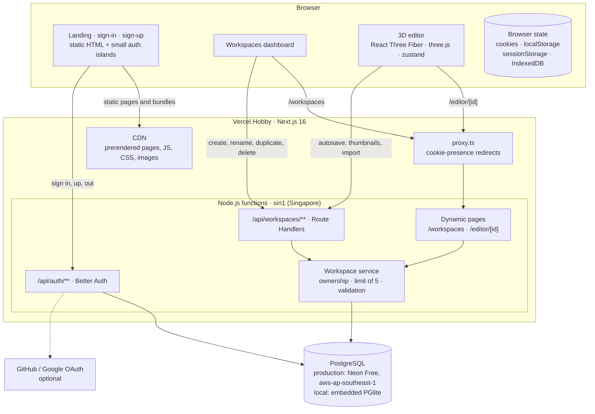

- **Anonymous traffic costs nothing on the server**: the landing, `/sign-in`, `/sign-up` and the
  guest editor `/editor` are prerendered and served from the CDN — no function invocation, no
  database query (§4, §6.5). Static pages learn "signed in?" only from the non-HttpOnly
  `artikin_auth` hint cookie (§7).
- **Browser state**: cookies (HttpOnly session token, 5-minute signed session cache, `artikin_auth`
  hint), `localStorage` (guest draft, per-device display preferences), `sessionStorage` (one-time
  guest → cloud import intent) and IndexedDB (imported models).
- Everything that touches user data runs in Node.js functions next to the database, behind a
  server-side session check. The **workspace service** (`src/server/workspaces.ts`) is the only code
  that reads or writes `workspace`; it enforces ownership, the per-user limit, size caps and the
  range-of-motion clamp.
- The **editor** is a client-only island (three.js never runs on the server). Guests keep their
  scene in `localStorage`; signed-in users autosave to the API (§11). Imported models stay in
  IndexedDB and are never uploaded (§9.11).
- Authentication, sessions and optional OAuth are handled by **Better Auth**, backed by the same
  database (§7).

## 2. Tech stack

Versions observed on npm on 2026-11-26; `package.json` is authoritative after scaffolding.

| Layer | Choice | Version | Why |
|---|---|---|---|
| Runtime | Node.js | 26.x locally (Vercel: current LTS) | Next.js requires ≥ 20.9 |
| Framework | **Next.js** (App Router, Turbopack) | 16.4.x | Vercel-native, RSC, Route Handlers, `proxy.ts` |
| UI library | **React** | 19.3.x | `@react-three/fiber` 9.8 requires `react >=19 <19.4` |
| Language | **TypeScript** (strict) | 5.x | Safety for a data-heavy 3D domain |
| Styling | **Tailwind CSS** 4 + **shadcn/ui** (Radix primitives) | 4.3 / CLI 4.x | Accessible components, fast iteration |
| 3D engine | **three.js** | 0.187 | De-facto WebGL engine |
| 3D in React | **@react-three/fiber** + **@react-three/drei** | 9.8 / 10.7 | Declarative scene; `OrbitControls`, `TransformControls`, `Outlines`, helpers |
| State | **zustand** + **zundo** (undo/redo) | 5.1 / 2.3 | Works inside and outside React render loop; temporal middleware |
| Validation | **zod** | 4.x | One schema for client & server |
| Auth | **Better Auth** | **1.7.x stable** (pin `^1.7.26`) | Email/password + OAuth, Drizzle adapter, DB sessions. ⚠️ npm `latest` tag currently points to `1.8.0-beta` — do not use. |
| ORM / migrations | **Drizzle ORM** + **drizzle-kit** | 0.45 / 0.31 | SQL-first, light, serverless-friendly, multi-driver |
| DB (production) | **PostgreSQL** on **Neon** (Vercel Marketplace) via **postgres.js** | `postgres` 4.x | Standard Postgres; pooled connections |
| DB (local & tests) | **PGlite** (embedded Postgres in WASM) | 0.5.x | Zero-install local DB, same SQL dialect as production |
| Unit/component tests | **Vitest** + Testing Library + jsdom | 5.x | Fast, ESM-native |
| E2E tests | **Playwright** | 1.65 | Real browser flows (Chromium with software WebGL) |
| Lint/format | ESLint (flat config, `eslint-config-next`) + Prettier | — | Consistency |
| Hosting | **Vercel** (Node.js runtime, Fluid compute) | — | Owner's requirement |

**Installed in M1 (exact versions; `package.json`/`package-lock.json` are authoritative):**
next 16.4.6 · react / react-dom 19.3.1 · typescript 5.9.3 · tailwindcss 4.3.5 (wired through the
`@tailwindcss/turbopack` loader, no PostCSS config) · shadcn CLI 4.23.0 (style `radix-nova`;
radix-ui 1.8.1, `cn` 0.5.2, lucide-react 1.75.0, sonner 2.0.8, next-themes 0.4.6, tw-animate-css
1.4.0) · three 0.187.0 · @react-three/fiber 9.8.2 · @react-three/drei 10.7.9 · zustand 5.1.0 ·
zundo 2.3.0 · zod 4.6.7 · better-auth 1.7.26 · drizzle-orm 0.45.4 · drizzle-kit 0.31.11 ·
postgres 4.1.1 · @electric-sql/pglite 0.5.16 · vitest 5.1.1 (vite 8.3.8, jsdom 31.0.1) ·
@testing-library/react 16.3.3 · @testing-library/jest-dom 8.0.0 · @playwright/test 1.65.1 ·
eslint 9.39.5 + eslint-config-next 16.4.6 · prettier 3.10.1 · tsx 4.23.15 (scripts) · cross-env
10.1.0 (env vars in npm scripts) · @next/env 16.4.6 (`.env` loading for tooling) · server-only 0.0.1.
Licenses: everything is MIT/Apache-2.0/BSD/ISC/0BSD except the items listed in PROGRESS §8 (R10),
which await a supervisor decision.

## 3. Repository layout & module dependencies

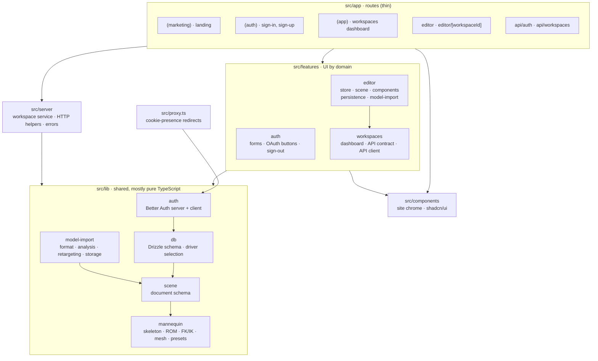

- Arrows point from the importing layer or module to the imported one; there are no cycles between
  layers. Inside `src/lib`: `auth` → `db` → `scene` → `mannequin`, and `model-import` → `scene`
  (and `mannequin`).
- `src/lib/mannequin` and `src/lib/scene` are pure TypeScript (three.js only in `materials.ts` and
  `mesh/three-rig.ts`), so the server reuses them for validation and the range-of-motion clamp. All
  three.js / React Three Fiber code lives in `src/features/editor/scene/`.
- Server code reuses two client-safe modules on purpose: `src/server` imports the API contract
  (`features/workspaces/contract.ts`), and `lib/auth` imports the destination sanitizer
  (`features/auth/callback-url.ts`). The editor talks to the API only through the typed client in
  `features/workspaces/api-client.ts`.
- `lib/config.ts` (client-safe limits) is imported across layers; `lib/config.server.ts` only on the
  server.

```
artikin/
├─ AGENTS.md · README.md            # rules for AI agents · quick start, scripts, free-hosting guide
├─ docs/                            # PROJECT, ARCHITECTURE, PROGRESS, TEST_PLAN, QA_REPORT, BRAND
│  ├─ screenshots/                  # visual evidence (engine, presets, landing, QA, model import)
│  └─ brand/generator/              # archived generator of the brand assets
├─ drizzle/                         # SQL migrations (drizzle-kit)
├─ public/brand/                    # logo, icons, illustrations
├─ scripts/                         # migrate.ts · dev-network-guard.cjs · normalize-lockfile.mjs
├─ tests/e2e/                       # Playwright: api/ · ui/ · editor/ · compliance/ · fixtures/ · helpers/
└─ src/
   ├─ proxy.ts                      # cookie-presence redirects (Next 16 "proxy", formerly middleware)
   ├─ app/
   │  ├─ layout.tsx · globals.css   # root layout (no client providers) · Tailwind + theme tokens
   │  ├─ icon.svg · favicon.ico · apple-icon.png · opengraph-image.png · robots.ts · sitemap.ts
   │  ├─ (marketing)/               # landing "/" (static) + _components/ (hero, plate sheet, FAQ, CTA)
   │  ├─ (auth)/                    # sign-in/ · sign-up/ (prerendered)
   │  ├─ (app)/                     # signed-in area: workspaces/ dashboard + loading and error states
   │  ├─ editor/                    # page.tsx = guest editor "/editor" (static) · layout.tsx
   │  │  └─ [workspaceId]/          # cloud editor (dynamic, owner only) + not-found and error pages
   │  ├─ api/auth/[...all]/         # Better Auth handler
   │  ├─ api/workspaces/            # GET list · POST create · [id]/ GET, PATCH, DELETE · duplicate/ · thumbnail/
   │  └─ dev/model-import/          # developer harness (answers 404 in production)
   ├─ components/                   # site-header · site-footer · user-menu · auth-switch · brand/ · ui/ (shadcn)
   ├─ features/
   │  ├─ auth/                      # sign-in/up forms, OAuth buttons, callback-url, sign-out
   │  ├─ workspaces/                # dashboard, cards, dialogs · contract.ts · api-client.ts
   │  └─ editor/
   │     ├─ editor-loader.tsx       # next/dynamic, client only
   │     ├─ editor-app.tsx          # layout, shortcuts, persistence slots (+ test-hook.ts)
   │     ├─ store/                  # zustand + zundo store, lock guards
   │     ├─ scene/                  # R3F: canvas, mannequin, FK rings, IK handles, move gizmo, bulbs,
   │     │                          # camera rig, capture, shadow cache, adaptive resolution
   │     ├─ components/             # toolbar, outliner, panels, presets/, dialogs, status bar
   │     ├─ hooks/ · lib/           # shortcuts, focus return · framing, render quality, prefs, labels
   │     ├─ persistence/            # autosave engine, cloud session, guest draft, guest → cloud
   │     └─ model-import/           # import dialogs, pipeline, assets, imported rig
   ├─ lib/
   │  ├─ config.ts · config.server.ts · utils.ts
   │  ├─ scene/                     # SceneDocument schema (zod), parse, defaults, ids
   │  ├─ mannequin/                 # bones, rom, kinematics, ik, pose-math, proportions, materials,
   │  │                             # mesh/ (procedural mesh, rig, picking), presets/ (pose, hand, body)
   │  ├─ model-import/              # format checks, analysis, retargeting, IndexedDB storage, testing/
   │  ├─ auth/                      # Better Auth server + client, session helpers, hint cookie plugin
   │  └─ db/                        # Drizzle schema (+ generated auth tables), client: postgres.js / PGlite
   ├─ server/                       # workspaces.ts (service) · http.ts · errors.ts
   ├─ test/                         # Vitest setup
   └─ types/                        # ambient types
```

Unit tests are colocated as `*.test.ts(x)`; E2E specs live in `tests/e2e/`.

**Implemented in M1 (S1)** — in addition to the tree above:

| Path | Purpose |
|---|---|
| `next.config.ts` | `distDir` from `NEXT_DIST_DIR`, PGlite external, security headers (+ HSTS in production builds, ADR-049), `typescript.ignoreBuildErrors` (ADR-013), `agentRules: false` (ADR-015), telemetry off (ADR-017), `experimental.agentUpgrade: false` (ADR-028), `images.unoptimized` (ADR-048), PGlite left out of output file tracing when `VERCEL=1` (ADR-050), Tailwind Turbopack loader |
| `vercel.json` | Vercel project settings kept in the repository: functions in `sin1` (Singapore), next to the Neon database in `aws-ap-southeast-1` (ADR-048) |
| `tsconfig.typecheck.json`, `src/types/next-ambient.d.ts` | Deterministic `npm run typecheck` (ADR-013) |
| `eslint.config.mjs`, `.prettierrc.json`, `.prettierignore` | Lint (ignores `.next*`, `.data`, `drizzle`, `.agent-locks`, test output) and formatting |
| `.env.example` (tracked) · `.env.local` (git-ignored, generated secret) | Environment (§16.1) |
| `components.json`, `src/components/ui/*`, `src/app/globals.css` | shadcn/ui (16 components) + dark theme tokens (dark `--destructive` keeps text ≥ 4.5:1, ADR-051); Tailwind scans only `src/` for class names (`source("../../src")`, ADR-047) |
| `src/components/placeholder-page.tsx` | Temporary page used by the M1 placeholders — delete when all routes are real |
| `src/lib/config.ts` · `src/lib/config.server.ts` | Client-safe limits · server-only env settings (`getServerConfig()`) |
| `src/lib/scene/{schema,parse,defaults,ids,index}.ts` | Scene document contract (§8) |
| `src/lib/mannequin/bones.ts` | Skeleton contract (§9.2) |
| `src/lib/db/{client,pglite,schema,auth-schema,test-utils,log,index}.ts` · `drizzle.config.ts` · `drizzle/0000_init.sql` | Database (§5, §6; `pglite.ts` is loaded only without `DATABASE_URL`, ADR-050) |
| `src/lib/auth/{auth,session,auth-client}.ts` · `src/app/api/auth/[...all]/route.ts` | Better Auth (§7) |
| `scripts/migrate.ts` | Production migrations (§6.2) |
| `scripts/normalize-lockfile.mjs` | `lockfile:normalize` / `lockfile:check` (§15, ADR-019) |
| `scripts/dev-network-guard.cjs` | Preloaded by `npm run dev`/`build`/`start`: fails requests to the public npm/Yarn registries in-process (§15, ADR-028) |
| `vitest.config.mts`, `src/test/{setup-dom,server-only-stub}.ts`, `playwright.config.ts` | Test infrastructure (§15) |
| `src/app/(marketing)/page.tsx`, `(auth)/sign-in`, `(auth)/sign-up`, `(app)/workspaces`, `editor`, `editor/[workspaceId]` | Placeholder pages (TODO S7/S3/S2/S4) |
| `src/app/editor/layout.tsx` | `<TooltipProvider>` + `<Toaster>` for both editor routes; the root layout mounts no client providers (§14, ADR-037) |

**Implemented in M2c (S7)** — landing, brand and site chrome (design system: [BRAND.md](./BRAND.md)):

| Path | Purpose |
|---|---|
| `src/app/(marketing)/layout.tsx` | Loads the landing display face (Archivo, width axis, `next/font/google` → `--font-archivo`) for marketing pages only; `export const dynamic = "error"` keeps every marketing page prerendered (the build fails on request-time APIs, ADR-043) |
| `src/app/(marketing)/page.tsx` | Landing `/`: **static** (○, served from the CDN — anonymous visits run no server code and no DB query), page metadata (title, description, canonical, Open Graph, Twitter card, `metadataBase`), workspace quota from `getServerConfig()` at build time; signed-in chrome via client islands (ADR-043) |
| `src/app/(marketing)/_components/*` | Hero + Fig. 1 "measurement plate" (inline illustration from the generated `hero-svg.ts` + SVG annotations, one CSS-module animation), feature "plate sheet" (Fig. 2–8 specimens: ROM table from PROJECT §7.4, IK diagram, orbit dial, light study, proportion lineup, lock diagram, workspace slots), how it works, FAQ (`<details>`), closing CTA (secondary CTA is an `AuthSwitch` island: "Sign up free" / "My workspaces"), copy deck `content.ts`, `SignedInToaster` (sonner `<Toaster>` as a lazy chunk, rendered through `AuthSwitch` only for signed-in visitors so the account menu's sign-out failure toast shows; the root layout has none, ADR-037) |
| `src/app/(marketing)/_lib/site-url.ts` | Public base URL (`BETTER_AUTH_URL` → `VERCEL_PROJECT_PRODUCTION_URL` → localhost) for metadata, robots and sitemap |
| `src/app/robots.ts` · `src/app/sitemap.ts` | `/robots.txt` (disallow `/api/`, `/workspaces`, `/editor/`) · `/sitemap.xml` (`/`, `/editor`) |
| `src/app/icon.svg` · `favicon.ico` · `apple-icon.png` · `opengraph-image.png` (+ `.alt.txt`) | App icons and social image via Next.js file conventions |
| `src/components/site-header.tsx` · `user-menu.tsx` · `user-menu-dropdown.tsx` · `site-footer.tsx` | Shared site chrome: `SiteHeader` (Server Component; `user?`, `nav?`, `actions?`, `mainId?` — pages rendered per request pass `user` (or `null`), static pages omit it and get the `HeaderAuthSwitch` island), `siteUserFromSession()`, `UserMenu` (client; `next/dynamic` wrapper so the dropdown — shadcn DropdownMenu + S3's `useSignOut` — loads only for signed-in users; without `user` it shows a generic avatar and fetches the account with `authClient.getSession()` only when opened, turning a stale hint into "Sign in"), `SiteFooter`. Links to routes that run server code (`/sign-in`, `/sign-up`, `/workspaces`) use `prefetch={false}` |
| `src/components/auth-switch.tsx` | Client islands `AuthSwitch` / `HeaderAuthSwitch` and their small store: read the `artikin_auth` hint through S3's `@/lib/auth/auth-hint` (`hasAuthHint`, the single source of the cookie contract) with `useSyncExternalStore` (server snapshot "signed out"), re-read on focus / visibility / back-forward restore and after `announceAuthHintChange()`; the header variant announces sign-outs and keeps focus. The islands never write the cookie — the auth server sets and clears it |
| `src/components/brand/logo.tsx` · `logo-data.ts` | `Mark` / `Lockup` as inline SVG (outlined wordmark, no font needed); geometry generated |
| `public/brand/*` | Illustrations (`hero-mannequin.svg`, `proportion-lineup.svg`), logo SVGs, 192/512/maskable PNGs |
| `docs/brand/generator/` | Archived asset generator (procedural mannequin, logo, icons, OG); run in a scratch copy, no project dependencies (README) |

The landing ships no three.js; its own client JavaScript is the auth islands (≈ 1 KB) plus, for
signed-in visitors only, the lazily loaded `UserMenu` dropdown and `SignedInToaster`.

The create-next-app favicon and SVGs were removed (original assets only); `public/brand/` now holds
S7's generated brand assets.

**Implemented in M2b (S3)** — auth UI, route protection, workspace service, API and dashboard:

| Path | Purpose |
|---|---|
| `src/server/workspaces.ts` | Workspace service (the only module touching `workspace`): `createWorkspaceService({ db, maxWorkspacesPerUser, sceneParseOptions? })`, `getWorkspaceService()`, `DEFAULT_SCENE_PARSE_OPTIONS` (ROM clamp, ADR-020), `nextDefaultWorkspaceName`, `copyWorkspaceName` |
| `src/server/errors.ts` · `src/server/http.ts` | `AppError` subclasses (`UnauthorizedError`, `NotFoundError`, `ValidationError`, `PayloadTooLargeError`, `WorkspaceLimitError`, `WorkspaceConflictError`) · `withSession()`, `readJsonBody()` (640 KB cap, JSON only), `discardRequestBody()` (unread bodies drained before answering, ADR-039), `jsonResponse`/`noContentResponse`/`toErrorResponse` |
| `src/app/api/workspaces/**` | Route handlers (§12) incl. `[id]/thumbnail` (cacheable preview images, ADR-057) + `workspaces-api.test.ts` |
| `src/features/workspaces/contract.ts` · `api-client.ts` | Client-safe API contract (`WorkspaceSummary`, `Workspace`, bodies, `ApiErrorCode`, `WorkspaceNameSchema`, `checkThumbnailDataUrl`, `MAX_REQUEST_BODY_BYTES`) · typed browser client `workspaceApi` / `createWorkspaceApiClient()` with `WorkspaceApiError` |
| `src/features/workspaces/*.tsx` · `relative-time.ts` | Dashboard: `WorkspaceDashboard`, `WorkspaceCard`, `UsageMeter`, `WorkspaceThumbnail` (+ `MannequinGlyph` placeholder), rename/delete dialogs, `useClock` / `formatEditedAt` |
| `src/app/(app)/{layout,error}.tsx` · `(app)/workspaces/{page,loading}.tsx` | Signed-in area with S7's `SiteHeader` and `<main id="main">`; server-loaded dashboard, skeleton, error boundary |
| `src/app/(auth)/**` · `src/features/auth/*` | Prerendered sign-in/up pages and forms (`useAuthForm`, `useAuthPageParams`, `AuthField`, `OAuthButtons`, `AuthShell`), `callback-url.ts` (open-redirect-safe destinations), `errors.ts` (Better Auth error → message), `schemas.ts`, `useSignOut` |
| `src/lib/auth/providers.ts` · `profile.ts` · `auth-hint.ts` · `session-hint-plugin.ts` | OAuth providers enabled by env (`getEnabledSocialProviders`) · profile normalization used by Better Auth hooks · client-safe hint cookie contract (`AUTH_HINT_COOKIE`, `hasAuthHint`) · Better Auth plugin keeping the hint in step and `GET /api/auth/session-expired` (ADR-056) |
| `src/proxy.ts` | Optimistic redirects (§7) |

## 4. Runtime boundaries & rendering strategy

Where a request goes (`npm run build` route table: `○` static, `ƒ` dynamic):

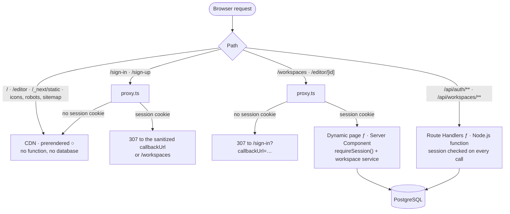

| Concern | Strategy |
|---|---|
| Landing, auth pages | **Prerendered** (served from the CDN, no function call): the landing (ADR-043) and `/sign-in`, `/sign-up` (ADR-056, `export const dynamic = "error"` in `(auth)/layout.tsx`). Client islands read what the server no longer sees: the hint cookie (landing) and `?callbackUrl` / `?error` (auth forms). No three.js in these bundles. |
| Dashboard | Server Component loads the user's workspaces through the service — **one DB query per render** while the session cookie cache is fresh; thumbnails are separate, cacheable image URLs (ADR-057); client components handle dialogs and mutations (fetch to the API, then `router.refresh()`). Card links do not prefetch the cloud editor. |
| Editor | `src/app/editor/**/page.tsx` (server) loads initial data (cloud editor) → renders `EditorRoot` (client) → `next/dynamic(..., { ssr: false })` for the R3F canvas. |
| API | Route Handlers on the **Node.js runtime** (postgres.js and PGlite need Node; no Edge). |
| Auth checks | `proxy.ts` checks only the session cookie's **presence** (no database): `/workspaces/:path*` and `/editor/:id` without it → `/sign-in?callbackUrl=…`; `/sign-in`, `/sign-up` with it → the sanitized destination. It never runs for `/`, `/editor`, the API or static assets. Every page and handler that touches user data re-validates the session server-side; a cookie the server rejects is cleared through `/api/auth/session-expired` (§7). |
| Caching model | `cacheComponents` is **off** (ADR-012): a route is prerendered unless it reads request data (`headers()`, `cookies()`, dynamic `params`), which makes it render per request. Pages that read the database must be dynamic (they read the session anyway) — PGlite refuses to open during `next build`. No `runtime` segment export is needed (Node.js is the default). |

## 5. Data model

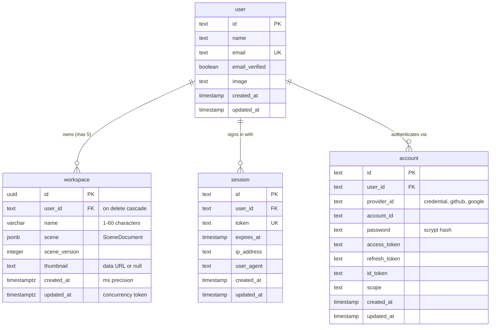

Standalone Better Auth tables (no relations):

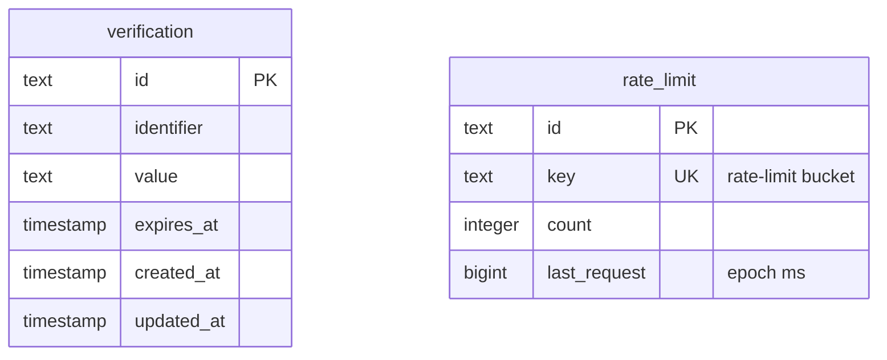

- `user`, `session`, `account`, `verification` and `rate_limit` are **generated** by the Better Auth
  CLI (`src/lib/db/auth-schema.ts`; plain `timestamp` columns, a few token-expiry columns of `account`
  omitted above) — regenerate, never hand-edit. A `rate_limit` key identifies one client and endpoint
  bucket.
- `workspace` is the only application table (`src/lib/db/schema.ts`):

| Column | Type | Constraints / notes |
|---|---|---|
| `id` | `uuid` | PK, `default gen_random_uuid()` |
| `user_id` | `text` | NOT NULL, FK → `user.id` **ON DELETE CASCADE** |
| `name` | `varchar(60)` | NOT NULL, trimmed, 1–60 chars |
| `scene` | `jsonb` | NOT NULL, validated `SceneDocument` (§8) |
| `scene_version` | `integer` | NOT NULL, equals `scene.version` (for data migrations) |
| `thumbnail` | `text` | NULL, `data:image/(jpeg|webp|png);base64,…`, ≤ 300 KB |
| `created_at` | `timestamptz` | NOT NULL default `now()` |
| `updated_at` | `timestamptz` | NOT NULL default `now()`, bumped on every update; optimistic-concurrency token |

Index: `(user_id, updated_at DESC)` for the dashboard listing.

**As implemented (M1):** `src/lib/db/schema.ts` defines `workspace` and re-exports the Better Auth
tables generated by the Better Auth CLI 1.7.26 into `src/lib/db/auth-schema.ts`: `user`, `session`,
`account`, `verification` and `rate_limit` (snake_case columns; the generated auth timestamps are
`timestamp` *without* time zone — regenerate, never hand-edit) plus `userRelations`,
`sessionRelations`, `accountRelations`. `workspace.created_at/updated_at` are **`timestamptz(3)`**
(millisecond precision) so `updated_at` round-trips exactly through JavaScript `Date`/ISO strings
— required for the optimistic-concurrency check (§6.4). Index `workspace_user_updated_idx`; check
constraint `workspace_name_not_blank` (`char_length(btrim(name)) > 0`). Initial migration:
`drizzle/0000_init.sql`.

## 6. Database operation

### 6.1 Driver selection — `src/lib/db/client.ts` *(implemented — M1)*

| Condition | Driver | Notes |
|---|---|---|
| `DATABASE_URL` set (production, or local Postgres) | `postgres` (postgres.js) → `drizzle-orm/postgres-js` | `prepare: false` (required with Neon/PgBouncer transaction pooling); small pool. |
| `DATABASE_URL` not set (local development) | `@electric-sql/pglite` → `drizzle-orm/pglite` | Data dir from `PGLITE_DATA_DIR` (default `.data/pglite`). Migrations applied automatically on first use. |
| Tests (Vitest) | In-memory PGlite (`new PGlite()`) | Fresh DB per test file, migrations applied in setup. |

- The DB instance is a **singleton cached on `globalThis`** to survive hot reloads.
- **PGlite is single-process**: never open the same data directory from two processes (e.g., a dev
  server and a script). Each agent uses its own `PGLITE_DATA_DIR` (see AGENTS.md).
- Production guard: when running on Vercel (`VERCEL=1`) without `DATABASE_URL`, fail fast with a
  clear error — PGlite cannot persist on serverless file systems.
- `@electric-sql/pglite` must be listed in `serverExternalPackages` in `next.config.ts`.
- **PGlite is loaded only by processes that use it** (ADR-050): every `@electric-sql/pglite` /
  `drizzle-orm/pglite` import lives in `pglite.ts` (and the test helper), and `client.ts` loads it
  through a conditional top-level `await import("./pglite")` when there is no `DATABASE_URL` and no
  `VERCEL=1`. Vercel builds leave the package out of every function bundle
  (`outputFileTracingExcludes`), so never import PGlite modules statically from app code — the
  functions would fail to load on Vercel.

Implementation notes (M1, ADR-014):
- `import { db } from "@/lib/db"` — one handle per process on `globalThis.__artikinDatabase`.
  Importing is side-effect free: postgres.js connects lazily, and PGlite is opened on the **first
  query**; a lazy client makes every query wait until all migrations are applied (log line
  `[db] Opening PGlite database at <dir>`). The parent of `PGLITE_DATA_DIR` is created if missing.
- `Database` = `PgDatabase<PgQueryResultHKT, DbSchema>` (driver-independent). `db.execute()` returns
  a driver-specific result shape (postgres.js: row array; PGlite: `{ rows }`) — use the query
  builder instead (e.g. `.for("update")` for row locks).
- postgres.js options (FT-03, ADR-057): `prepare: false`, **`max: 1`** (one connection per function
  instance), `idle_timeout: 20` s, **`max_lifetime: 300`** s, `connect_timeout: 10` s — idle
  connections close quickly, so no connection keeps Neon's compute awake (it scales to zero after
  5 idle minutes). Inside `db.transaction` only `tx` may be used (a second query on `db` would wait
  for the single connection — the same rule PGlite already imposes).
- Query shape (FT-03/FT-04, ADR-057): list, create, update and duplicate read only summary columns
  — `thumbnail IS NOT NULL`, never the image (≤ 300 KB) or the scene (≤ 256 KB); `get` adds the
  scene, `getThumbnail` reads only the image; duplicate copies scene and image inside the database
  (`INSERT … SELECT`, 3 queries in the transaction).
- Diagnostics: `DB_LOG_QUERIES=1` logs every query's SQL text (never its parameters) as
  `[db] <sql>` — for counting round trips per request locally. `describeErrorForLog()`
  (`src/lib/db/log.ts`) reduces an error to class names + SQLSTATE for logs (PROJECT §14, §13).
- Guards: `createDatabaseFromEnv()` throws on Vercel without `DATABASE_URL`; PGlite refuses to open
  while `NEXT_PHASE=phase-production-build` (parallel build workers must never share a data dir).
- Tests: `createTestDb()` from `src/lib/db/test-utils.ts` → isolated in-memory PGlite with all
  migrations applied (`{ db, client, close }`).

### 6.2 Migrations

- Source of truth: `src/lib/db/schema.ts` (Drizzle). `npm run db:generate` writes SQL to `drizzle/`.
- Local (PGlite): applied automatically at startup by the DB client (dev/test only).
- Production: `npm run db:migrate` (`scripts/migrate.ts` with the postgres.js migrator), executed by
  `npm run vercel-build` before `next build` when `DATABASE_URL` is present.
- Never edit a generated migration after it has been applied anywhere; add a new one instead.
- Commands (M1): `npm run db:generate` (drizzle-kit; `drizzle.config.ts` loads `.env*` through
  `@next/env`) · `npm run auth:generate` (Better Auth CLI `auth@1.7.26` → `src/lib/db/auth-schema.ts`;
  follow with `db:generate`; keep the CLI version equal to `better-auth`) · `npm run db:migrate`
  (`scripts/migrate.ts`: no-op without `DATABASE_URL` locally, exit 1 on Vercel without it).

### 6.3 Workspace limit enforcement

The limit must hold even under concurrent requests (two tabs clicking *New* at the same time):

```ts
// src/server/workspaces.ts (sketch)
return db.transaction(async (tx) => {
  // Serialize creations per user by locking the owner's row.
  await tx.execute(sql`select id from "user" where id = ${userId} for update`);
  const [{ value }] = await tx.select({ value: count() }).from(workspace)
    .where(eq(workspace.userId, userId));
  if (value >= config.maxWorkspacesPerUser) throw new WorkspaceLimitError(config.maxWorkspacesPerUser);
  const [row] = await tx.insert(workspace).values({ userId, name, scene, sceneVersion }).returning();
  return row;
});
```

- Duplicate goes through the same code path.
- The limit comes from `config.maxWorkspacesPerUser` (`MAX_WORKSPACES_PER_USER`, default 5) and is
  returned by `GET /api/workspaces`, so the UI never hard-codes it.
- As implemented in M1: read the limit with `getServerConfig().maxWorkspacesPerUser`
  (`src/lib/config.server.ts`), and take the row lock with the query builder —
  `tx.select({ id: user.id }).from(user).where(eq(user.id, userId)).for("update")` — rather than
  `tx.execute(sql…)` (driver-specific result shape, §6.1).
- As implemented in M2b (S3, `src/server/workspaces.ts`): inside one transaction the owner's row is
  locked, then the owner's workspace **names** are read (their count is checked against the quota and
  the lowest free "Untitled workspace N" is picked under the same lock), then the row is inserted;
  `duplicate` locks, reads the owned source (404 first), checks the quota, inserts. In Postgres
  (READ COMMITTED) a blocked transaction re-reads after the lock is released, so concurrent creates
  count one after another. PGlite runs every query and transaction through one mutex, so concurrency
  is serialized there anyway (never call the top-level `db` inside `db.transaction` on PGlite — it
  would wait for itself). Tests: 5 concurrent creates at 4/5 → exactly one succeeds; 12 creates +
  3 duplicates at 1/5 → exactly four succeed (`src/server/workspaces.test.ts`); real-Postgres twin
  is S6's DEP-04.

### 6.4 Optimistic concurrency

`PATCH` accepts `baseUpdatedAt`. The update runs with
`WHERE id = $id AND user_id = $user AND updated_at = $baseUpdatedAt`; zero rows → if the row exists
for this user → `409 CONFLICT` (with the current `updatedAt`), else `404`. Without `baseUpdatedAt`
the update is last-write-wins (used for explicit *Overwrite*).

As implemented (M2b, S3): every update sets
`updated_at = greatest(clock_timestamp(), updated_at + interval '1 millisecond')` — database time,
strictly increasing even for two writes within one millisecond (ADR-025) — and `RETURNING` hands the
new token to the client. Tokens are ISO strings with millisecond precision (`toISOString()`);
`baseUpdatedAt` must be an ISO date-time (else 400).

### 6.5 Free-tier budget (FT-01…FT-04, S3)

Goal (owner: free hosting on Vercel Hobby + Neon Free): anonymous traffic costs no function
invocation and no query; signed-in use touches the database rarely. Measured on a local production
build (`DB_LOG_QUERIES=1`, one user with 3 workspaces, 2 with a 35 KB thumbnail; HTTP cache on):

| Journey | Before | After |
|---|---|---|
| Anonymous `/sign-in` | 0 queries; page rendered per request | 0 queries; prerendered page (only the proxy runs) |
| Sign-in → dashboard | 20 queries · 12 server requests | 9 queries (sign-in 6, list 1, first fetch of 2 thumbnails) · 4 |
| Dashboard load | 12 queries · 9 requests · 120 KB document | **1 query** (the list) · 13 KB document · thumbnails from the browser cache |
| Repeat dashboard load | 12 queries | **1 query** |
| Signed-in visit to `/sign-in` | 14 queries | 1 (proxy redirect, then the dashboard) |
| Dashboard after the 5-minute cookie cache expired | — | 3 (session, user, list) |

Before, every dashboard view also prefetched each card's `/editor/<id>` (editor page = session +
user + workspace queries) and sign-in rendered its destination twice (`router.replace` +
`router.refresh`); both are gone. Thumbnails cost one query the first time a browser sees a given
version.

**No cron in v1.** Nothing needs periodic work: Better Auth deletes an expired session when it
meets it and prunes `rate_limit` rows older than the longest window while rate limiting. Leftovers
(sessions of users who never return, expired `verification` rows, idle `rate_limit` keys) are a few
hundred bytes each. If the 1 GB storage ever matters, run once by hand in the Neon SQL editor:
`DELETE FROM session WHERE expires_at < now(); DELETE FROM verification WHERE expires_at < now();
DELETE FROM rate_limit WHERE last_request < (extract(epoch FROM now()) * 1000 - 86400000);`
(a Vercel cron would wake the database on schedule, so it is deliberately not set up).

## 7. Authentication (Better Auth)

| Piece | Location | Notes |
|---|---|---|
| Server instance | `src/lib/auth/auth.ts` | `betterAuth({ database: drizzleAdapter(db, { provider: "pg", schema }), emailAndPassword: { enabled: true, minPasswordLength: 8, maxPasswordLength: 128, autoSignIn: true }, socialProviders: { github?, google? }, account: { accountLinking: { enabled: false } }, session: { expiresIn: 30 days, updateAge: 1 day, cookieCache: 5 min }, rateLimit: { enabled: true, storage: "database", customRules }, trustedOrigins, plugins: [sessionHint(), nextCookies()] })` |
| HTTP handler | `src/app/api/auth/[...all]/route.ts` | `toNextJsHandler(auth)`; `maxDuration = 10` |
| Browser client | `src/lib/auth/auth-client.ts` | `createAuthClient({ sessionOptions: { refetchOnWindowFocus: false } })` → `signUp.email`, `signIn.email`, `signIn.social`, `signOut`, `useSession` |
| Server helpers | `src/lib/auth/session.ts` | `getSession()` (pages; cookie cache, else database) · `getRouteSession(request)` (route handlers; also returns Better Auth's `Set-Cookie` headers) · `requireSession()` |
| Hint cookie + stale sessions | `src/lib/auth/auth-hint.ts` (client-safe) · `src/lib/auth/session-hint-plugin.ts` | `artikin_auth=1` for static pages; `GET /api/auth/session-expired` clears rejected session cookies |
| Route guard | `src/proxy.ts` | Cookie-presence redirects for `/workspaces/:path*`, `/editor/:id`, `/sign-in`, `/sign-up`; **not** a security boundary |

- Social providers are registered only when both client id and secret env vars exist; the UI asks the
  server which providers are enabled.
- In development, trusted origins include `http://localhost:3000–3010` so several agents' dev servers
  on different ports can sign in.
- As implemented (M1): `baseURL` = `BETTER_AUTH_URL` when set (required in production; a local
  production build logs a warning without it); otherwise, in development, a dynamic base URL with
  `allowedHosts` `localhost:3000–3010` and `localhost:3100` (http). `trustedOrigins` = the same
  localhost origins in development. `rateLimit: { storage: "database" }` (Better Auth enables rate
  limiting in production by default; table `rate_limit`). `telemetry: { enabled: false }`.
  `getEnabledSocialProviders()` (`src/lib/auth/providers.ts`, M2b) tells the UI which OAuth buttons to show.
  `requireSession(redirectTo = "/sign-in")` redirects; Route Handlers call `getSession()` and answer
  401. `BETTER_AUTH_SECRET` is required by `next build`/production (Better Auth throws on the default
  secret in production). Verified on :3001 — sign-up 200 + HttpOnly `better-auth.session_token`,
  `get-session` 200 (30-day expiry), duplicate email 422, foreign `Origin` 403.
- As implemented (M2b, S3):
  - `createAuth({ database, env?, rateLimitEnabled? })` builds the instance (`auth` =
    `createAuth({ database: db })`); `src/lib/auth/auth.test.ts` builds one on an in-memory DB and checks:
    scrypt hash only (`salt:hash`), cookie `HttpOnly; SameSite=Lax; Path=/`, case-insensitive emails,
    the same 401 for a wrong password and an unknown email, 8/128-char passwords accepted and 7/129
    refused, the 4th sign-in or sign-up within 10 s from one IP → 429 (DB-backed bucket; other IPs
    unaffected), a foreign `Origin` → 403, session 30 days / refresh 1 day.
  - Rate limiting: `enabled` in production (explicit), `storage: "database"`. Better Auth's
    **built-in rules** are kept for the endpoints that matter — `/sign-in*` and `/sign-up*`
    3 / 10 s per client IP (S6's E2E depends on them), password and email flows — and every other
    path is exempt (`RATE_LIMIT_RULES`, first matching key wins, last key `"/**": false`; FT-01,
    ADR-055): each limited request reads and writes `rate_limit`, which session checks, sign-out and
    OAuth callbacks no longer pay. Client IP (`getClientIpHeaders()`, ADR-042, S6 QA L2): on Vercel
    (`VERCEL=1`) `x-vercel-forwarded-for`, then `x-real-ip` — set by Vercel's edge, client-sent
    values are replaced, so a spoofed `X-Forwarded-For` is ignored; elsewhere Better Auth's default,
    a **single-address** `X-Forwarded-For` (lists are skipped), which is only trustworthy behind
    exactly one proxy that overwrites it (local E2E uses it to simulate client IPs). Other hosts must
    set `advanced.ipAddress.ipAddressHeaders` / `trustedProxies` for their proxy chain.
  - **Session cookie cache** (FT-01, ADR-055): `session.cookieCache` 5 minutes — Better Auth adds the
    HMAC-signed HttpOnly cookie `better-auth.session_data` (Max-Age 300) and answers session checks
    from it; the database is read again after 5 minutes (`refreshCache` stays off — it is meant for
    database-less setups). A revoked session therefore stays usable for up to 5 minutes. Server
    Components cannot set cookies, so the cache is renewed by API responses (`withSession` forwards
    Better Auth's `Set-Cookie` headers) and auth endpoints; until then a page render reads the
    session from the database (2 queries).
  - Browser client: `sessionOptions.refetchOnWindowFocus: false` — no session request per tab focus;
    nothing in the app mounts `useSession`.
  - **Auth hint cookie** (FT-02, ADR-056; contract shared with S7's landing): `artikin_auth=1`,
    `Path=/`, `SameSite=Lax`, `Secure` on https, **not** HttpOnly, `Max-Age` = the session's expiry,
    no personal data. The `sessionHint()` plugin's after-hook sets it whenever a session is created
    or refreshed (email sign-in/sign-up, OAuth callback) and clears it whenever a response deletes the
    session cookie (sign-out, stale sessions) and when a session check finds no session while the
    hint is present (it also restores a missing hint on a successful check). The proxy drops it
    when the session cookie is missing. Read it with `hasAuthHint(document.cookie)`
    (`src/lib/auth/auth-hint.ts`); it is a UI hint only, never an authorization signal.
  - **Stale sessions**: `requireSession()` that finds no session while the request still carries a
    session cookie redirects to `GET /api/auth/session-expired?callbackUrl=<path>` (plugin endpoint,
    not rate-limited). It re-checks the database (`disableCookieCache`), and only if the session is
    really gone deletes the session cookies (and thereby the hint) and continues to
    `/sign-in?callbackUrl=…`; a valid session is sent back to the destination. Without this hop the
    proxy (session cookie → away from `/sign-in`) and the page (no session → `/sign-in`) would
    redirect to each other forever. Verified live: revoked elsewhere → `/workspaces` →
    `302 /api/auth/session-expired` → `/sign-in`, all cookies cleared.
  - `advanced.disableOriginCheck: false` — Better Auth skips its Origin/CSRF check under
    `NODE_ENV=test` unless told otherwise; forcing it keeps tests honest (no effect in dev/production).
  - `databaseHooks.user.create/update.before` normalize profile input (`profile.ts`): name trimmed,
    whitespace collapsed, ≤ 60 characters (empty → email local part); `image` only for `https:` URLs.
  - OAuth: providers registered only with both env vars (`providers.ts`), read **at build time** by
    the prerendered auth pages (redeploy after changing them); failures redirect to
    `/sign-in?error=<code>` (`onAPIError.errorURL`), shown as a form error. **Account linking is off**
    (`account.accountLinking.enabled: false`, ADR-041, S6 QA M2): password sign-ups are not
    email-verified, so linking an OAuth identity to an existing account by email would allow account
    pre-hijacking; such a sign-in ends on `/sign-in?error=account_not_linked` ("An account with this
    email already exists. Sign in with your email and password.").
  - Logging: `logger.log = logAuthEvent` — Better Auth messages print as `[auth] <message>
    (<error class names> (SQLSTATE …))`; other arguments are dropped, because database errors embed
    SQL parameters (emails, session tokens). Same reduction as the API's 500 log
    (`describeErrorForLog`, `src/lib/db/log.ts`; PROJECT §14).
  - Cookies use Better Auth's defaults: `HttpOnly`, `SameSite=Lax`, `Path=/`; `Secure` and the
    `__Secure-` prefix when `BETTER_AUTH_URL` is `https://`. Extra trusted origins (e.g. Vercel
    preview URLs) go into `BETTER_AUTH_TRUSTED_ORIGINS` (comma-separated, read by Better Auth).
  - `src/proxy.ts` (matcher `/workspaces/:path*`, `/editor/:id`, `/sign-in`, `/sign-up` — never `/`,
    `/editor`, the API or static assets; FT-03): checks only the presence of
    `better-auth.session_token` / `__Secure-better-auth.session_token` (`getSessionCookie`, no
    database). Without it, protected pages → `307 /sign-in?callbackUrl=<path+query>`; with it,
    `/sign-in` and `/sign-up` → `307` to the sanitized destination — which is what lets both pages
    be prerendered (ADR-056). Pages call `requireSession("/sign-in?callbackUrl=…")`, route handlers
    use `withSession` (401). The sign-in/up forms read `?callbackUrl` and `?error` in the browser
    (`useAuthPageParams`, `useSyncExternalStore` with a "no query" prerender snapshot) and navigate
    with a single `router.replace` (no extra `router.refresh()` render). Destinations (`callbackUrl`,
    also `callbackURL`) must be same-origin paths (`src/features/auth/callback-url.ts`: no `//`,
    backslashes, control characters or auth pages, checked again **after URL normalization** — dot
    segments such as `/.//host`, `/a/..//host` or `/%2e//host` collapse into a protocol-relative
    `//host`, S6 QA M1) — otherwise `/workspaces`. Links between the auth pages and to the cloud
    editor do not prefetch (each prefetch would run the proxy or the editor page).
  - Sign-out: `useSignOut()` (`src/features/auth/sign-out-button.tsx`, used by S7's `UserMenu`) →
    `authClient.signOut()` deletes the session row (a replayed cookie gets 401) and clears the hint → `/`.

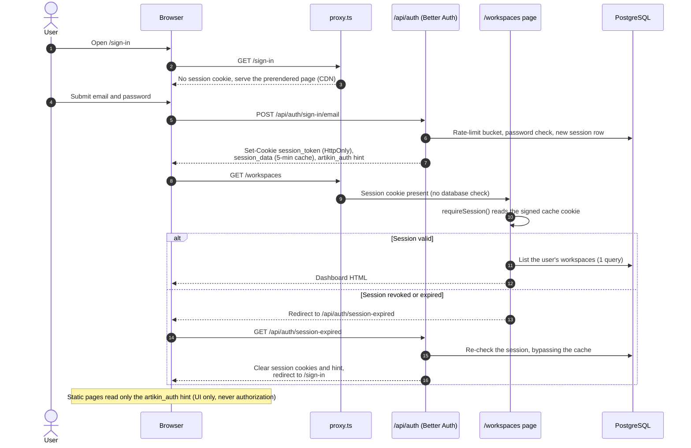

## 8. Scene document — the shared contract

Defined in `src/lib/scene/` *(implemented — M1; import from `@/lib/scene`)*: zod schema, inferred TypeScript types,
`SCENE_VERSION`, `createDefaultScene()`, `parseScene(unknown)` (validate + migrate older versions +
clamp poses to ROM + drop unknown keys).

```jsonc
{
  "version": 1,
  "mannequins": [
    {
      "id": "fig_8f3k2",
      "name": "Figure 1",
      "presetId": "classic-wooden",
      "proportions": {},                         // overrides of the preset's defaults
      "material": { "style": "wood", "color": "#d9b48f" },
      "transform": { "position": [0, 0.98, 0], "rotation": [0, 0, 0] }, // hips world pos (m) + rot (deg)
      "pose": { "leftUpperArm": [0, 0, 8], "leftLowerArm": [12, 0, 0] }, // sparse, semantic [flex, twist, side] degrees
      "locked": false,
      "visible": true
    }
  ],
  "lights": [
    {
      "id": "light_1", "name": "Key light", "kind": "bulb",
      "position": [1.1, 2.4, 0.9],
      "intensity": 0.45,                          // normalized 0..1 (UI 0–100 %)
      "colorTemperature": 4500,                  // Kelvin; null when a custom color is used
      "color": "#fff1e0",
      "castShadow": true, "shadowSoftness": 0.4, "visible": true
    }
  ],
  "environment": {
    "ambient": 0.25,
    "background": "#2b2d31",
    "floor": { "visible": true, "grid": true, "shadowOnly": false },
    "shadowQuality": "medium"
  },
  "camera": { "position": [3.6, 2.55, 5.35], "target": [0, 1.2, 0], "focalLength": 50, "projection": "perspective" },
  "lock": { "pose": false, "lights": false, "view": false }
}
```

Rules:
- `pose` is a **sparse** map `HumanBoneName → [flex, twist, side]` — **semantic** signed degrees
  relative to the neutral pose, with the same anatomical meaning on both sides (PROJECT §7.4), so
  mirroring is a copy. Missing bones are `[0, 0, 0]`. `hips` is not in `pose`; it is `transform`.
  Out-of-range values are clamped by `parseScene` through the ROM clamp hook (S2's `rom.ts`).
- `transform.position` is the **hips** world position; *Drop to floor* recomputes `y` from the lowest
  vertex of the figure.
- Light `intensity` is normalized; the renderer maps it to physical units — so renderer tuning never
  breaks saved scenes.
- `lock` holds the scene-wide locks (PROJECT F6, §10): `pose`, `lights` and `view` (camera angle;
  additive — documents without it parse as unlocked). Locks are saved with the scene but are not undo
  steps (ADR-034); each figure also has its own `locked`.
- Bounds: ≤ 8 mannequins, ≤ 4 lights, names ≤ 40 chars, all numbers finite and range-checked,
  serialized size ≤ 256 KB. Unknown keys are stripped.
- Any change to the schema bumps `SCENE_VERSION` only when not backward compatible, and adds a
  migration step in `parseScene`.

**Implementation (M1)** — `schema.ts` (zod schemas, types, `SCENE_VERSION`, `SCENE_BOUNDS`),
`parse.ts`, `defaults.ts`, `ids.ts`, barrel `index.ts`; tests in `scene.test.ts`.

| API | Behavior |
|---|---|
| `parseScene(input, { clampPose? })` | `input`: object or JSON text. Returns `{ ok: true, scene, migratedFrom }` or `{ ok: false, error: { code, message, issues: [{ path, message }] } }` with `code` ∈ `INVALID_JSON` · `TOO_LARGE` (text or result > 256 KB) · `UNSUPPORTED_VERSION` (newer than `SCENE_VERSION`, or no migration path) · `VALIDATION_ERROR`. Never throws for bad input. |
| `PoseClampHook` | `(pose, { mannequin }) => pose` in semantic degrees; applied to every figure after validation; its output is re-validated (an invalid result throws — programming error). S2 plugs `clampPose` from `rom.ts`/`pose-math.ts` here. |
| `parseSceneOrThrow` | Same, throws `SceneParseFailure` (`code`, `issues`). |
| `SCENE_MIGRATIONS` / `migrateRawScene` | Migration registry keyed by the version it upgrades from (empty for v1). |
| `serializeScene(scene, { maxBytes? })` · `measureSceneBytes` | JSON text; throws `SceneTooLargeError` above 256 KB (UTF-8 bytes). |
| `createDefaultScene()` | Fresh object: `fig_1` "Figure 1" (`classic-wooden`, wood `#d9b48f`, neutral pose, hips at `[0, 0.98, 0]`), `light_1` "Key light" (`[1.1, 2.4, 0.9]`, 0.45, 4500 K, shadows), ¾ front-left camera (`[3.6, 2.55, 5.35]` → `[0, 1.2, 0]`, 50 mm) that shows the whole figure and the key bulb (S2, approved; unit test in `editor-store.test.ts`). |
| `createSceneObjectId("fig" \| "light", existingIds?)` | Random id like `fig_k3v9x0qa`, unique within the scene. |

Validation details: positions within ±50 m (camera ±100 m); figure `transform.rotation` is
`[pitch, yaw, roll]` degrees within ±180 with the semantic signs of PROJECT §7.4 (pitch + = tip
forward, yaw + = turn toward the figure's left, roll + = lean toward the figure's left); pose angles
within ±180 before ROM clamping (unknown bones and `hips` are dropped); `proportions` = sparse
overrides of the 11 `BodyProportions` keys (§9.3; units defined by `proportions.ts`, sanity bound
0–10); `intensity`, `shadowSoftness`, `ambient` 0–1; `colorTemperature` 2000–10000 K or `null`;
`focalLength` 18–200 mm; `projection` `perspective` | `orthographic`; colors `#rrggbb` (lowercased);
ids `[A-Za-z0-9_-]{1,64}`, unique across figures and lights; preset ids kebab-case ≤ 40; names
trimmed, 1–40 chars. Omitted `locked`/`visible`/`pose`/`proportions` default to
`false`/`true`/`{}`/`{}`. Limits come from `src/lib/config.ts`.

**Imported model reference (S8, additive — v1.1, §9.11):** a figure may carry
`model: { source: "local", id, name, format }` — `id` = lowercase SHA-256 hex of the file (64 chars,
uppercase accepted and lowercased), `name` = the user's file name (trimmed, 1–80 chars, no control
characters, `MODEL_NAME_MAX_LENGTH`), `format` ∈ `MODEL_FORMATS` (`"vrm"`, `"glb"`). Absent = the
procedural mannequin; documents without it parse unchanged. Only the reference is ever stored: the
file stays in the browser's IndexedDB and unknown keys inside `model` are stripped, so no file data
can reach a workspace or a guest draft (`src/lib/scene/model-ref.test.ts`). Types
`MannequinModelRef`, `ModelFormat`.

## 9. 3D editor engine

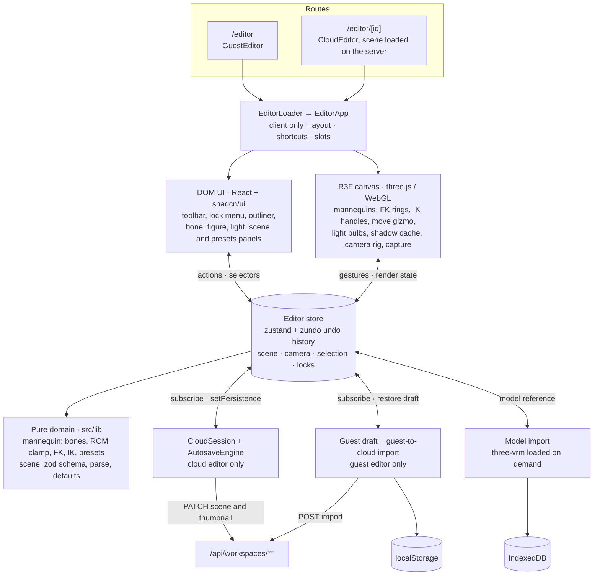

- **One store, two views**: React panels and the R3F canvas read the same zustand store and change it
  only through its actions, which clamp every pose to the range of motion and apply the lock guards
  (§10). Drags are wrapped in gestures, so each drag is one undo step.
- **The canvas never owns document state**: the rig, gizmos and handles render the store; the camera
  is stored too (saved with the scene, never an undo step).
- **Persistence plugs in from outside** through `onStoreReady` and the toolbar/banner/overlay slots:
  the guest editor writes a local draft, the cloud editor autosaves through the API (§11).
- **Imported models** replace a figure's procedural rig in the canvas; the store keeps only the
  reference (§9.11).

### 9.1 Scene graph *(implemented — M2a, S2)*

```
<Canvas shadows="percentage" frameloop="demand" dpr={[1, 2]} gl={{ antialias, alpha }}>  Neutral tone mapping, sRGB
  <SceneEnvironment/>   background colour + hemisphere ambient (ambient × AMBIENT_SCALE 3.2)
  <Floor/>              shadow-receiving plane (radial fade into the background) or shadow-only; finite grid
  <LightBulbs/>         per light: pointLight (decay 2, castShadow) + glass/cap meshes + invisible pick sphere
  <Mannequins/>         per figure: ONE rigid-skinned SkinnedMesh + skeleton (+ inverted-hull outline for toon)
  <BoneGizmo/>          Rotate tool: one ring per unlocked DOF of the selected joint
  <IkHandles/>          Drag tool: hand / foot / head-look / hips handles of every editable figure
  <MoveGizmo/>          Move tool: turn ring on the floor around the selected figure
  <CameraRig/>          OrbitControls (makeDefault, damping) + view-preset / frame / turntable animation
  <CaptureController/>  PNG export & thumbnails (engine.capture)
  <EngineBridge/>       engine hooks for the test hook (project, frame count, render stats, pending frames)
</Canvas>
```

`RigRegistry` (React context) maps `mannequinId → three.js rig` for gizmo, handles and capture. The
canvas is client-only (`EditorLoader` → `next/dynamic`, `ssr: false`); `EditorApp` owns the store,
layout, shortcuts and the gated test hook.

Module boundary: everything in `src/lib/mannequin/**` is **pure TypeScript without three.js** (usable
by the server's clamp hook and by node unit tests) except `materials.ts` and `mesh/three-rig.ts`.
All three.js / R3F code lives in `src/features/editor/scene/`.

### 9.2 Skeleton & range of motion — `src/lib/mannequin/` *(implemented)*

- `bones.ts` (S1) — `HumanBoneName` union (VRM 1.0 naming, 51 bones), ordered list, parent map, side and
  mirror map (`leftX ↔ rightX`), groups (torso, arm, hand, leg) for UI and resets.
  *Implemented (M1):* `HUMAN_BONE_NAMES` (hierarchy order — parents first), `ROOT_BONE`,
  `PosableBoneName`/`POSABLE_BONE_NAMES` (50, no `hips`), `BONE_PARENT` (shoulders → `chest`, upper
  legs → `hips`), `BONE_CHILDREN`, `BONE_SIDE`/`getBoneSide`, `BONE_MIRROR`/`mirrorBoneName`,
  `BONE_GROUP`/`getBoneGroup`/`BONES_BY_GROUP`/`getBonesOf(group, side)` with groups `torso` (hips,
  spine, chest), `head` (neck, head), `arm` (shoulder → wrist `*Hand`), `hand` (thumb + fingers),
  `leg`; `FINGER_BONE_SUFFIXES`/`FingerBoneSuffix`, `sideBoneName`, `getBoneAncestors`, type guards.
- `rom.ts` — **single source of truth** for limits and semantics. `ROM_LIMITS` = the signed limits of
  PROJECT §7.4 (locked DOFs `[0, 0]`); anatomical labels per DOF; visible DOFs (non-zero range) for
  gizmo rings and sliders. Mapping semantic DOF → (local axis, sign) per joint kind, written for the
  left side; the right side mirrors it (rotations about X keep their sign, about Y/Z flip; bind
  quaternions mirrored `(w, x, −y, −z)`), so mirroring a pose is a plain copy. Parametrization:
  Euler with a per-kind order (the unused axis in the middle) for most joints; **swing-twist
  (exponential map) for the shoulder ball joint `*UpperArm`** — no gimbal lock at T-pose; the hip
  `*UpperLeg` stays Euler flex → side → twist (gimbal only at 90° abduction, outside the range;
  presets such as cross-legged need large twists in a predictable order); the thumb metacarpal has a
  fixed bind rotation. API: `semanticToQuat`, `quatToSemantic` (gizmo / IK read-back), `clampDof`,
  `clampBone`, `getBoneRom`, and `dofMotion(bone, dof, angles)` → instantaneous rotation axis (parent
  frame) and rad/° (used by the gizmo rings and the IK solver).
- `quat.ts` (pure quaternion/vector math), `kinematics.ts` (pure FK: `forwardKinematics(layout, pose,
  root)` → world positions/orientations; `rootTransformOf(transform)` from the semantic hips
  `[pitch, yaw, roll]`).
- `pose-math.ts` — **`clampPose` is the scene's `PoseClampHook`** (`parseScene(input, { clampPose })`,
  used by S3's API and by the editor — ADR-020); `clampBone`, `setBoneAngles`, `mirrorPose`,
  `swapSides`, `applyPosePreset`, `applyHandPreset(side | "both")`, resets.
- Semantic tests: `rom.test.ts` (limits = §7.4 table, MAN-15 semantics, MAN-08 round trips, POSE-02
  visible DOFs), `pose-math.test.ts` (MAN-05 clamp fuzz, mirror involution, MAN-09 hook via `parseScene`).
- Clavicle note: `*Shoulder` elevation/protraction rotates the whole arm about the sternoclavicular
  pivot, so a raised arm also tilts slightly inward; there is no automatic scapulohumeral rhythm.
  Overhead reach = `*UpperArm` side up to 180° (+ optional shoulder elevation ≤ 30°); S5's presets keep
  shoulders at 0 for reach-up / jump.

### 9.3 Procedural mesh — `src/lib/mannequin/mesh/` *(implemented)*

- `proportions.ts` — `BodyProportions` uses exactly the scene's `PROPORTION_KEYS` (overrides are
  sparse in the document); `PROPORTION_PARAMS` drives validation, sliders and presets:

  | Key | Unit | Range | Meaning |
  |---|---|---|---|
  | `height` | m | 0.8–2.2 | standing height |
  | `headSize` | head ÷ height | 0.11–0.42 | shown as "heads tall" (1 / value) |
  | `neckLength`, `shoulderWidth`, `chest` | × | 0.5–1.8 · 0.75–1.35 · 0.75–1.35 | multipliers |
  | `waist`, `hipWidth` | × | 0.7–1.4 · 0.75–1.4 | multipliers |
  | `armLength`, `legLength` | × | 0.85–1.2 · 0.85–1.25 | multipliers (torso adapts to legs) |
  | `limbThickness`, `muscularity` | × · 0–1 | 0.65–1.5 · 0–1 | thickness, muscle bulges |
  | `handSize`, `footSize` | × | 0.75–1.25 | extremity multipliers (additive contract change, approved) |

  `computeSkeleton(p)` → `SkeletonLayout` (bone offsets, lengths, rest positions, dimensions for the
  mesh builders). `figure-model.ts` caches `getFigureModel(presetId, proportions)` (layout + geometry;
  the key is the resolved proportions **plus the preset's face style**, so custom proportions keep
  their preset's face) and computes `groundedHipsHeight` (lowest posed vertex at y = 0, CPU skinning
  in `mesh/skin.ts`).
- `mesh/build.ts` — generated, never loaded: revolved profiles (pelvis, abdomen, ribcage, neck, limbs
  with muscle bulges, elliptical cross-sections), superellipsoids (palm, toes), the sculpted egg head
  (`mesh/head.ts`), spheres (ball joints, slightly darker tint), capsules (3 phalanges per finger,
  thumb metacarpal), lofted feet. **One geometry per figure; every vertex carries exactly one bone
  index (rigid skinning)** → one `SkinnedMesh`, one draw call per figure (PERF-08: 1 mesh, + 1
  outline for toon). `buildMannequinGeometry(layout, faceStyleId)`; 18,169 vertices / 32,552
  triangles per figure (was 16,093 / 28,496 with the faceless head: +14 %).
- **Faces** (ADR-061) — `mesh/face.ts`: nine generic `FaceStyle`s (neutral, male, female, child;
  realistic or anime) as data in head heights — eye line, nose base and mouth line above the chin;
  socket size/depth and lid mound; brow ridge and its arch; nose length, projection, bridge, wings,
  tip and upturn; lip width/fullness and cupid's bow; midface fill, chin (projection, width,
  round → square), cheekbones, jaw taper (negative = broader jaw) — mapped per body preset by
  `FACE_STYLE_BY_PRESET` (no scene-schema change). Men and women differ in every feature group:
  heavy straight brow over deep narrow sockets / soft arched brow over large almond eyes with a
  visible lid; long wide nose with a strong bridge and wide nostrils / small narrow upturned nose;
  wide thin mouth / full lips with a cupid's bow; broad jaw and square chin / tapered jaw and soft
  chin (unit test MAN-17). `createFaceRelief(style)` turns a style into a smooth (C1),
  mirror-symmetric relief field: orbit bowl and the crease under the brow, almond closed-lid mound,
  brow ridge and nasion, nose (ridge profile + wings as a smooth union), closed lips with the line
  between them and the cupid's bow, chin, cheekbones, midface. `mesh/head.ts` builds the egg (same
  profile as the faceless head: chin −0.26, crown +0.74 head heights from the head joint) on a
  non-uniform, mirror-symmetric 56 × 52 grid — denser columns over the face with one exactly on the
  centreline, rows focused on the eyes, nose underside and lips — and offsets its front along +Z by
  the relief (plus a lateral jaw taper), so the grid cannot fold and the head height is unchanged.
  Head normals come from the grid's own vertices (`gridNormals`, central differences): relief finer
  than the grid would otherwise alias into speckles. For the toon material the geometry also
  carries `toonNormals` (normals of the egg with only the face's broad forms — nose, sockets with
  lids, both lips as one volume — which keeps the cel terminator clean) and `toonCavity` (0…1: the
  upper-lid creases, the nostrils/under-nose shadow and the lip line, which the cel pass draws in
  the shadow tone whatever the light, so anime faces read as drawn features at drawing distance);
  all other vertices repeat their normals and have no cavity. Imported models (§9.11) are
  unaffected.
- Picking: R3F raycasts the `SkinnedMesh` (three skins the hit triangles), `boneFromFace(geometry,
  face.a)` reads the `skinIndex` → bone; `mesh.userData.mannequinId` identifies the figure.
  `geometry.parts` lists `{ name, bone, start, count }` vertex ranges — the PROJECT §7.3 segment → bone
  mapping (pelvis → `hips`, abdomen → `spine`, ribcage → `chest`, `upper-arm`, `forearm`, `palm`,
  `thigh`, `shin`, `foot`, `toes`, `<finger>-<segment>`, `thumb-<segment>`; a joint ball belongs to
  its child bone, e.g. the elbow ball → `*LowerArm`). Unit test MAN-03 (`build.test.ts`) checks the
  mapping and that every vertex of a part carries its bone index. E2E resolves bones with
  `project({ kind: "bone" })` (segment centroid + occlusion check) and real clicks.
- `mesh/three-rig.ts` — three.js rig (bones, `SkinnedMesh`, fixed bounding sphere 1.15 × height
  around the hips — valid for any pose), toon outline hull sharing the skeleton, `applyPose`. The
  geometry gets `toonNormal` and `toonCavity` attributes (the toon data above). The outline hull skips its screen
  offset where `toonNormal` faces the camera but differs from the true normal — the face's small
  creases (lid crease, lip line), which would otherwise flicker as stray strokes while orbiting;
  silhouettes, the nose contour and the whole body keep the full outline.

### 9.4 Materials — `src/lib/mannequin/materials.ts` *(implemented)*

| Style | Implementation |
|---|---|
| Wood | `MeshStandardMaterial` roughness 0.52 + procedural grain (seeded 512 × 256 `CanvasTexture`, streaks along the limb UVs — original asset) |
| Clay | `MeshStandardMaterial`, roughness 0.95 |
| Plaster | `MeshStandardMaterial`, roughness 0.9 |
| Toon | `MeshToonMaterial` with a 2-step ramp (terminator at dot(N, L) ≈ 0.2) + a post-lighting cel pass: two flat tones — lit = the picked colour × the light's hue, shadow (form or cast) = darker, more saturated shade whose depth follows the ambient fill (50–85 %) — not tone-mapped; lit with the `toonNormal` attribute (the face's broad forms only, ADR-061); face cavities (`toonCavity` > 0.5: lid creases, nostrils, lip line) take the shadow tone with an anti-aliased edge, before the selection highlight (which still applies on top, one draw call); inverted-hull outline (≈ 2.2 px, constant on screen) |

Default tint per style: `MATERIAL_DEFAULT_COLORS` (S5); switching the style follows the new style's
default tint unless the tint was customised. Selection/hover highlight is injected with
`onBeforeCompile` (per-vertex level from `skinIndex` → still one draw call) and applied **after
lighting**: the selected bone is recoloured toward sky blue `#1f9bff` keeping its luminance (adding
blue to orange wood would read grey/violet), a hovered bone brightens with a light-blue fresnel rim,
and a whole selected figure (Move tool) only gets the rim.

### 9.5 Interaction model *(implemented)*

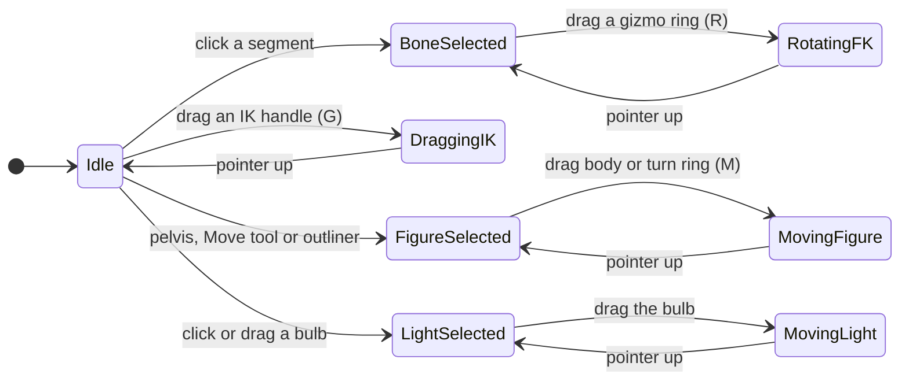

Every drag ends on pointer up as exactly one history (undo) step. From any selection, Esc, a click on
empty space or turning a lock on returns to Idle. Pose transitions need the figure's pose unlocked,
light transitions need the lights unlocked.

- Tools: **Rotate (FK)** `R` (default), **Drag (IK)** `G`, **Move figure** `M`. Clicks that moved
  > 4 px are orbit drags, not clicks; drags on empty space orbit the camera.
- **Gizmo rings** (`scene/bone-gizmo.tsx`, no `TransformControls`): one ring per unlocked DOF of the
  selected joint (knee: one ring), constant 74 px on screen, coloured flex red / side blue / twist
  green (`lib/dof-colors.ts`); a ring's normal is the DOF's current `dofMotion` axis, so dragging it
  changes exactly that semantic value. Dial mode (angle around the joint's screen centre) when the
  ring faces the camera, tangent mode when it is edge-on; Shift = fine (¼), Ctrl = 5° snap. The value
  is clamped by `clampDof` (motion stops smoothly at the limit); hover/drag shows the allowed range as
  a wedge plus a value label.
- **IK** (`ik.ts`, `scene/ik-handles.tsx`): handles for hands, feet, head (look target) and hips (move
  the body with both feet planted). The target is the pointer ray ∩ the camera-facing plane through
  the handle; the solver runs at most once per frame. CCD over semantic DOFs (via `dofMotion`),
  elbow/knee solved analytically first (length match), arm/leg chains use `*UpperArm`/`*UpperLeg`
  flex + side only, feet keep their world orientation, head look = neck + head (0.5 each), clamping
  every iteration; deterministic, no NaN, stable at unreachable targets (POSE-05, MAN-07, POSE-11).
- **Move tool** (`scene/mannequin.tsx`, `scene/move-gizmo.tsx`): drag the body across the floor
  (horizontal plane through the grab point; Shift = vertical lift), turn ring for the yaw (Ctrl = 15°).
- **Bulbs**: drag in the camera-facing plane (Shift = horizontal plane); 9 cm invisible pick sphere.
- Event priority: rings, IK handles and the turn ring draw on top (`depthTest: false`) and are marked
  `userData.overlay`; the mannequin yields pointer events to them even though the body is nearer in
  the raycast order. Drags use pointer capture, disable the orbit controls synchronously on
  pointer-down and wrap the edit in `beginGesture`/`endGesture` (one undo step per drag).
- **Picking** (`mesh/rig-picking.ts`): three's `SkinnedMesh.raycast` CPU-skins every triangle on every
  call (~30 k per figure, tens of ms per pointer move on slow CPUs). The rig installs a rigid-skin
  raycast instead: the ray is moved into each bone's bind space, tested against a per-bone box, then
  against that bone's triangles only (nearest boxes first). Same nearest hit as three (`face.a` →
  bone via `skinIndex`; unit-tested against three's raycast on a posed, moved figure). While a drag
  or an orbit holds the pointer, R3F hover raycasts are skipped entirely (`editor-canvas.tsx` wraps
  the event `compute` and sets a zero layer mask; captured targets still receive `e.ray`).
- Central guards `canEditPose(scene, mannequinId)`, `canEditLights(scene)` and `canMoveCamera(scene)`
  (`store/guards.ts`, plus `isMasterLocked` / `lockSummary` / `lockNotice` for the UI) are used by
  pointer handlers, gizmos, handles, panels, presets and shortcuts — the only place where lock rules
  live. Locked figures show a `not-allowed` cursor and a "Pose locked" toast/status hint; their gizmo
  and handles are not rendered and drags fall through to the orbit controls (which ignore them while
  the view is locked, §9.6).
- Keyboard-only posing: `bone-picker` (select element listing every posable bone) + per-DOF sliders.

### 9.6 Camera *(implemented — `scene/camera-rig.tsx`)*

- `PerspectiveCamera`; vertical FOV from focal length on a 36 × 24 mm sensor:
  `fov = 2 · atan(24 / (2 · f))` (f = 50 mm → ≈ 27°); near 0.03 m, far 300 m.
- `OrbitControls`: damping 0.14, azimuth unlimited, polar angle `[0.05, π − 0.05]`, distance
  0.3–30 m, pan enabled. View presets (1–5, ¾ views) and Frame selection (`F`) animate 420 ms on a
  sphere around the target (instant with reduced motion); the turntable is driven per frame (stops
  exactly when switched off; `autoRotate` is not used).
- **Framing** (`lib/framing.ts`, ADR-060): `fitView` places the camera for a fixed viewing direction so
  that point sets fit the frame for the current lens (vertical FOV) and canvas aspect, each set with its
  own per-side limits — exact for a fixed orientation: per screen axis the frustum's side planes are
  pushed against the extreme points, the tighter axis sets the distance, the other axis is centred on
  the figures (then moved only as far as other sets need). The target is on the optical axis at the
  figures' depth centre; directions are clamped to the orbit's polar limits, distance 0.35–30 m.
  `framingSets` builds the sets from the scene: posed vertices of each visible figure plus its floor
  contact (footprint grown by 0.25 m at y = 0) with an 8 % margin (`FIGURE_FRAME_LIMIT` 0.84), the
  selected joint's vertices (limit 0.75), a 0.6 m box around a selected bulb, and — for the default
  view — every visible bulb 36 px inside the edges and left of the top-right camera views cluster
  (marked `data-viewport-overlay="top-right"`, measured from the DOM). View presets frame every
  visible figure head-to-toe from their direction; `F` frames the selection (every visible figure when
  nothing is selected).
- **Auto framing** (default view): a scene whose camera is still at the factory placement of
  `createDefaultScene()` (`isFactoryCameraPlacement`: position and target) has never been moved, so the
  rig frames it itself — figures head-to-toe with their floor contact and the bulbs, from the default
  ¾ direction — and re-frames when the canvas is resized or the focal length changes. The placement
  stays in the document (nothing is saved, so opening a scene never creates a camera change for
  autosave — COST-04) until the user moves the camera: any camera change the rig did not make (orbit,
  wheel, pan, touch, preset, `F`, turntable) ends auto framing and the next save stores the real view;
  a click that does not move the camera keeps it; locking the view saves the angle on screen.
  `getDocument().camera` therefore reports the factory placement while auto framing; the hook's
  `project()` always uses the live camera. Scenes with any other saved camera (e.g. test fixtures)
  open at that camera.
- The camera is written to the store when an orbit/animation ends (rounded to mm) — never an undo
  step; writes that change nothing are dropped (`setCamera`), so a click on the background is not a
  document change.
- **View lock** (PROJECT F6, ADR-059): while `lock.view` is on, the store refuses every camera command
  (`requestView`, `requestFrameSelection`, `placeCamera`, focal-length changes, switching the turntable
  on — toast "View locked — press V to unlock the camera"); locking (or loading a view-locked
  document) stops a running turntable. The rig
  sets `enableRotate` / `enableZoom` / `enablePan` to false (mouse, wheel and touch; `enabled` stays
  free for gizmo/handle drags to toggle) and `dampingFactor` to 1. When the lock engages, the angle on
  screen becomes the locked camera: one update consumes the damping tail of an orbit that is still
  coasting, the camera returns to where it was and is saved (mm-rounded). Every frame then holds the
  camera at the stored position/target after one OrbitControls update — a fixed point of its
  distance/polar limits, so holding never loops. A loaded document's camera is applied before the
  lock captures the screen (the command effect is a layout effect declared before the lock effect).
  Resizes change only the aspect (the vertical FOV follows the focal length), and a reload restores
  the same view (LOCK-15).

### 9.7 Lighting & shadows *(implemented)*

- `<Canvas shadows="percentage">` (PCF; `PCFSoftShadowMap` was removed in three r187). three r187
  filters point-light shadows with 5 Vogel taps rotated by per-pixel noise (meant for TAA), which
  shows as stippled grain on the body; `scene/shadow-sampling.ts` patches the chunk once at load to
  12 fixed taps (smooth penumbra; unit-tested; leaves three untouched if the chunk changes).
- Bulb: `pointLight` (`decay = 2`), intensity = normalized × `MAX_BULB_INTENSITY` (55 cd); shadow map
  512/1024/2048 by the scene's shadow quality, capped by the device's rendering quality (§9.8), near 0.05 m, far 40 m; radius = 1 + 6 × softness; normalBias =
  (0.014 + 0.02 × softness) × √(1024 / map size); bias −0.0004. Glass colour follows the light colour
  and brightness.
- Ambient: `hemisphereLight` (#f4f1ec / #5d5a55), intensity = `environment.ambient` × 3.2.
- Floor: radial fade into the background colour 7 → 22 m from the origin, mixed after tone mapping
  and the sRGB conversion so the far floor equals the cleared background exactly (no horizon line).
  Grid: finite 40 m plane with 1 m segments fading 18 m from the origin (drei's infinite grid is two
  ~1 km triangles whose near-plane clipping makes it vanish at some camera angles).

### 9.8 Render loop & performance *(implemented; perf pass P-01…P-05, ADR-044…046)*

- `frameloop="demand"`; pose / light / camera changes are applied imperatively from store
  subscriptions and `invalidate()`; IK solves at most once per frame. Idle = 0 frames (PERF-05).
  Panels subscribe to the smallest value they show (the outliner to id / name / visibility / lock
  strings; the gizmo's angle label is written through a ref), so a drag re-renders only the bone
  sliders and the status readout.
- One draw call per figure. Each figure's bounding sphere is refit to the pose (`updateRigBounds`:
  bone origins + per-bone part radii), so frustum culling — including each cube face of a
  point-light shadow — skips empty views (typically 3 of 6 faces instead of all 6).
- **Shadow-map cache** (`scene/shadow-signature.ts`): `shadowMap.autoUpdate = false`; in
  `scene.onBeforeRender` (after the frame's matrix update) a signature of shadow casters and lights
  — caster and bone matrices, visibility, geometry, light transforms, map sizes, missing maps —
  decides whether the shadow maps are redrawn. Orbit, zoom, turntable, selection and hover never
  redraw shadows; pose, figure and light edits do (also when made by undo, presets or code paths that
  bypass the store).
- **Adaptive resolution** (`scene/adaptive-resolution.tsx`, `lib/render-quality.ts`): an
  `InteractionTracker` (`scene/interaction.ts`: drag gestures, orbit / pan, camera motion including
  damping, wheel, view animations and the turntable) decides per frame whether the view is moving —
  a drag or orbit holds the pointer, the camera changed within the last 180 ms, or it changed during
  the previous frame (so slow continuous motion never flips to full resolution between frames). The
  pixel ratio — full at rest, lower while moving — is applied in a frame callback before the render,
  so the canvas resize and the new image land in the same task (no blank frame). A change reallocates
  the canvas (a stall on software GL), so the ratio is latched for a whole gesture and Auto's
  adjustments apply from the next one. Once no frame is queued, one full-quality frame is rendered;
  until then the test hook's `isIdle()` reports a pending frame. Toon outlines keep their rest width.
- **Rendering quality** — a per-device view preference (`lib/view-prefs.ts`, localStorage
  `artikin:prefs:v1`, zod-validated; Scene settings → Display, `scene-render-quality`). It is not part
  of the scene document (a workspace opened on another device must not inherit this device's GPU
  budget) and not an undo step:

  | Profile | Pixel ratio at rest | While interacting | Shadow-map cap | MSAA |
  |---|---|---|---|---|
  | Auto (default) | device, ≤ 2 (unchanged look) | starts at ≤ 1, then ×0.8 / ×1.25 from the median frame interval (> 34 ms / < 22 ms), floor 0.5 | scene setting | on |
  | High | device, ≤ 2 | as at rest | scene setting | on |
  | Balanced | device, ≤ 1.5 | ≤ 1 | 1024 | on |
  | Low | ≤ 1 | 0.75 | 512 | off (recreates the WebGL context) |

- Memory: geometry is shared per figure model (refcounted, `acquireGeometry`); textures are module
  singletons; a rig's `dispose` releases its skeleton's bone-matrix texture (previously leaked one
  texture per rebuild — material or body change) and its geometry reference.
- **Overlay programs** (`scene/overlay-programs.ts`): gizmo rings, range wedges, IK handles and the
  turn ring are created per selection, and three destroys a shader program with its last material,
  so every new selection recompiled them on first hover (≈ 0.1 s on ANGLE/D3D, seconds on software
  GL). One hidden material per program variant (face culling × tone mapping), compiled in the
  background with `compileAsync` and again when the lights change, keeps them cached for the session.
- Measurements (before / after): §14.
### 9.9 Export & thumbnails *(implemented — `scene/capture-controller.tsx`)*

`engine.capture({ scale: 1 | 2 | 4, transparent, includeFloor, includeBulbs })`: hides helpers
(`userData.artikinRole` helper / bulb / floor / grid), clears the selection/hover highlight, raises the
pixel ratio (longest edge ≤ 4096 px), renders once and reads the canvas in the same task (works
without `preserveDrawingBuffer`), then restores everything. The export dialog downloads
`artikin-<local date-time>.png`. S4's thumbnails use the same capture (`persistence/thumbnail.ts`).
### 9.10 Preset data formats — contract between S2 (engine) and S5 (content)

`src/lib/mannequin/presets/types.ts` *(implemented — the types below plus `MaterialStyle`)*:

```ts
/** Semantic degrees per PROJECT §7.4 — identical meaning for left and right. */
export type SemanticAngles = [flex: number, twist: number, side: number];

export interface PosePreset {
  id: string;            // kebab-case, unique ("fighting-stance")
  name: string;          // English UI label
  category: "standing" | "locomotion" | "sitting" | "kneeling" | "lying" | "action" | "gesture";
  /** Body bones (fingers excluded unless includesHands). Omitted bones are reset to [0, 0, 0]. */
  pose: Partial<Record<Exclude<HumanBoneName, "hips">, SemanticAngles>>;
  hips?: {
    orientation?: [pitch: number, yaw: number, roll: number]; // degrees relative to upright (PROJECT §7.4)
    height?: number;     // × standing hips height; only used when grounded === false (e.g. jump = 1.15)
  };
  grounded?: boolean;    // default true → "drop to floor" after applying
  includesHands?: boolean; // default false → finger bones untouched
  tags?: string[];
}

export type FingerBoneSuffix =
  | "ThumbMetacarpal" | "ThumbProximal" | "ThumbDistal"
  | `${"Index" | "Middle" | "Ring" | "Little"}${"Proximal" | "Intermediate" | "Distal"}`;

export interface HandPreset {
  id: string;
  name: string;
  /** Applied to `left${suffix}` and/or `right${suffix}`; omitted finger bones reset to [0, 0, 0]. */
  fingers: Partial<Record<FingerBoneSuffix, SemanticAngles>>;
  tags?: string[];
}

export interface BodyPreset {
  id: string;            // PROJECT §8.1 presetId
  name: string;
  description: string;
  proportions: BodyProportions;               // defined by S2 in proportions.ts (§9.3)
  material: { style: "wood" | "clay" | "toon" | "plaster"; color: string };
}
```

Applying a full-body preset keeps the figure's floor position (x, z) and heading (yaw), sets hips
orientation/height from the preset, writes all body bones, then grounds the figure if `grounded`.
Every preset must pass `clampPose` unchanged (unit test: preset values are already within limits).

**Preset library (S5, implemented)** — `src/lib/mannequin/presets/`:

| File | Content |
|---|---|
| `pose.ts` | 19 full-body presets `POSE_*` in `POSE_PRESETS` (PROJECT F10 list; generic poses only), `POSE_NEUTRAL` (reset, not in the catalogue), `ENGINE_POSE_PRESETS` = catalogue + neutral, `DEFAULT_POSE_PRESET` = `POSE_RELAXED_STAND` (no hips orientation, because new figures and "Reset to default" apply it as a plain pose), `POSE_CATEGORY_LABELS` (UI order) |
| `hand.ts` | 10 hand presets `HAND_*` in `HAND_PRESETS` (relaxed, fist, open, flat, point, peace, thumbs-up, grip, pinch, claw); `DEFAULT_HAND_PRESET`; `ENGINE_HAND_PRESETS` alias. Full-body presets embed them via `includesHands` (finger entries copied per side); `includesHands` without finger entries = straight fingers (T/A-pose) |
| `body.ts` | 9 body presets of PROJECT §8.1 (P0 + P1; chibi P2 not shipped) with all 13 proportion keys incl. `handSize`/`footSize`, default material per style (`MATERIAL_DEFAULT_COLORS`) |
| `pose-analysis.ts` | Test/tuning-only analysis on the real engine (`forwardKinematics` + rigid-skinned mesh): floor contacts per body region from posed vertices, centre of mass from segment masses (Dempster/Winter) and its margin inside the support polygon, capsule self-intersection, surface landmarks. Places a preset exactly like the store's `applyPosePreset`. Never imported by the app at runtime |
| `*.test.ts` | Contract (ids, names, categories, ROM no-op, symmetry, hips/grounded fields), plausibility of every pose on the default body (intended contacts, balance ≥ 1–3 cm, hand targets) and on all 9 bodies (allowed contacts, balance, no deep intersection), body presets vs PROJECT §8.1 measured on the built mesh (height ±2 %, heads ±0.2), IP denylist on all preset texts |

Presets UI: `src/features/editor/components/presets/` — `PresetsPanel` (tabs Pose · Hands · Body; pose
tiles grouped by category; hand target radiogroup left/right/both; body tiles with `aria-pressed`;
every button disabled when `canEditPose` is false; body tiles also disabled, with a hint to switch
back to the mannequin, while the figure shows an imported model — `model` set, PROJECT §18, S8 — because body
presets only shape the procedural mannequin, whereas pose/hand presets drive the skeleton),
`preview-shapes.ts` (pure: SVG preview geometry
from the engine's FK — ¾-view stick figure, palm-side hand, same-scale body silhouette — cached per
preset, no image assets) and `preset-preview.tsx` (renderer). Mounted at the bottom of the
properties panel; test ids per TEST_PLAN §6.2. Preset screenshots: `docs/screenshots/presets/`.

### 9.11 Imported models (VRM / GLB) — `src/lib/model-import/`, `src/features/editor/model-import/` *(S8, M5 — v1.1)*

Users can show **their own** humanoid model instead of the procedural mannequin. Files are read,
analysed and stored **only in the browser** (IndexedDB) and never uploaded; scenes keep only the
reference (§8). **Nothing derived from an imported model reaches the servers either** (supervisor
decision, privacy + IP): while any figure of the scene has `model` set, the cloud editor uploads no
new workspace thumbnail (the last mannequin-only thumbnail stays, otherwise the dashboard
placeholder; S4's persistence implements the skip). A user-initiated PNG export is a local download
and stays allowed. Artikin ships no model files; tests and the dev harness use original humanoids
generated in code (`src/lib/model-import/testing/`).

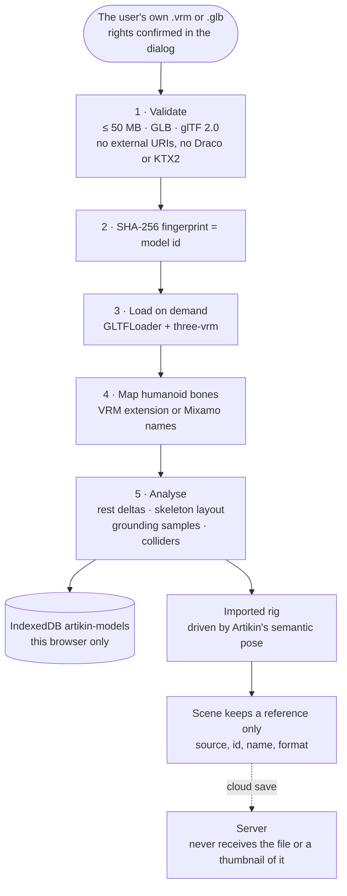

| Step | Module | Behaviour |
|---|---|---|
| Validate | `lib/model-import/format.ts` `inspectModelFile` | ≤ 50 MB (`MAX_MODEL_BYTES`; `File.size` is checked before reading), GLB container, glTF 2.0; VRM 1.0 (`VRMC_vrm`) / 0.x (`VRM`) detection. Refused with a `ModelImportError` code: text `.gltf`, FBX, Draco / KTX2 (their decoders would be downloaded), **any external `uri`** (loading it would be a network request) |
| Fingerprint | `lib/model-import/storage.ts` `sha256Hex` | Web Crypto; the digest is the scene reference id (same file = same id on every device) |
| Load | `features/editor/model-import/load-model.ts` (dynamic import — three-vrm and the glTF loader stay out of the editor's initial bundle) | three `GLTFLoader` (+ bundled `MeshoptDecoder`) with a loading manager that only lets `blob:`/`data:` URLs through; VRM via `@pixiv/three-vrm` `VRMLoaderPlugin` — only its humanoid mapping and materials (MToon) are used: the normalized helper rig is removed and `vrm.update()` is never called (no spring bones, expressions or look-at). The file's own VRM 1.0 license URL is accepted (the user confirmed their rights) |
| Map | VRM humanoid extension (`getRawBoneNode`, 51 bones + `upperChest`) or Mixamo-style node names (`lib/model-import/name-map.ts`: `mixamorig[N]:` prefixes, three-sanitised names) | Required: the VRM 1.0 required set (hips, spine, head, upper/lower arms, hands, upper/lower legs, feet) — otherwise `UNSUPPORTED_RIG` listing the missing bones |
| Analyse | `lib/model-import/analysis.ts` `analyzeRig(RigSource)` (pure; the rig source comes from `extract-rig-source.ts`) | See below |
| Store | IndexedDB `artikin-models` (`meta` + `files` stores, Blob) | Only after a successful analysis; `QUOTA_EXCEEDED` / `STORAGE_UNAVAILABLE` errors |

**Analysis** (pure TypeScript; `analysis.test.ts`, `load-model.test.ts`):
- *Normalisation:* up = hips → head, left = right → left limbs → rotation that makes the model face
  +Z with its left at +X (VRM 0.x faces −Z); unit fix when the rest height is outside 0.3–3.5 m
  (× 0.01, × 0.001, × 100, else scaled to 1.7 m); the hips joint becomes the origin ("root space").
- *Rest deltas N* (two-vector alignment, per mapped bone): arms, hands and fingers point down with
  the knuckle axis (little → index) forward, so palms face the thighs whatever the file's rest pose
  (T, A, …); thumbs go to `THUMB_REST_DIRECTION` with the palm normal as roll reference; legs point
  down with the knee forward; feet only yaw to point forward (they stay flat); torso, neck, head and
  clavicles keep the model's own rest posture.
- *Layout:* the model's joints in that neutral pose become an Artikin `SkeletonLayout` (offsets, rest
  frames incl. thumb binds, lengths, dims), so FK, IK handles, gizmos, grounding and the test hook
  use the model's real joints. Optional bones the model lacks degrade gracefully: neck → coincides
  with the head, shoulder → with the upper arm, chest → with the spine (the spine node is then driven
  by `chest`), finger/thumb chains → first mapped descendant or synthesised from the procedural layout
  scaled to the model, toes → the front of the foot surface.
- *Grounding samples:* the model surface (skinned at rest, dominant weight) moved rigidly into the
  neutral pose per driver bone; per bone its extremes along 26 directions plus a stride subsample →
  `MannequinGeometryData` with `boneIndices` in `BONE_INDEX` order, so `groundedHipsHeight`,
  `restBoneCentroids` and camera framing work unchanged.
- *Colliders:* one capsule per bone (joint → child joint, radius = 80th percentile of the bone's
  sample distances), bone-local.
- *Derived proportions* (height, head size, leg/arm length, shoulder/hip width, hand/foot size, neck
  length; clamped to the slider ranges) are merged into the figure's `proportions` when the model is
  assigned, so a device without the file shows a mannequin of roughly the model's size.
- *Retargeting plan* (`retarget.ts`): per driven node `{ driver, N, R0, parent, parentOffset }`;
  node rotation (root space) = (A_driver · A0_driver⁻¹) · N · R0, converted to the local rotation under
  the nearest driven ancestor; undriven nodes (hair, twist bones, `upperChest`, eyes) keep their rest
  locals. Verified: the model's joints coincide with Artikin FK within 1e-6 m (pure) / 1e-4 m (three.js
  clone) over random in-range poses and seven rig variants (VRM 1.0/0.x, Mixamo, T/A pose, cm units,
  bone-aligned frames, missing fingers/toes/shoulders/neck/chest).

**Runtime (client):** `assets.ts` (one asset per file, shared by figures; registers its `FigureModel`
for `resolveFigureModel(m)` in `lib/model-import/figure-model.ts` — the pure resolver the store, IK,
engine bridge, camera and move gizmo use instead of `getFigureModel`), `model-status.ts` (`loading`,
`ready`, `missing`, `error`), `pipeline.ts` (`importModelFile`, `ensureModelLoaded`,
`removeModelFromDevice`), `apply-model.ts` (assign/clear through the store action
`setMannequinModel`, with the lock notice). `imported-rig.ts` `createImportedRig(asset, mannequinId)`
implements `MannequinRig`: invisible proxy bones in Artikin conventions (gizmos, IK, `applyPoseToRig`
unchanged), an invisible rigid-skinned capsule **pick proxy** (`skinIndex` = `BONE_INDEX`, S2's
`rig-picking.ts` raycast and pose-fitted bounds, so `updateRigBounds` applies) that also draws the
selection / hover overlay (x-ray: a translucent capsule for the selected / hovered bone, a faint tint
with a rim glow for the whole figure), and a `SkeletonUtils.clone` of the model under a normalizer
group (own materials, cast/receive shadows — covered by the shadow-map cache signature —,
`frustumCulled = false`, raycast disabled); `sync()` retargets after each pose change; `dispose()`
also frees the bone textures of the proxy and the clone. Entry points:
`@/features/editor/model-import/scene` (canvas code) and `@/features/editor/model-import/ui` (DOM:
`ModelImportRoot`, `AddFigureImportEntry`, `FigureModelSection`).

**Editor integration** (cross-edits in S2's files, approved by the supervisor): `scene/mannequin.tsx`
builds `createImportedRig` instead of the procedural rig while the figure's asset is loaded (body
preset, proportions and material then don't rebuild it), calls `rig.sync()` after `applyPoseToRig`,
routes the highlight to `rig.setHighlight` and adds no toon outline; `resolveFigureModel(m)` replaces
`getFigureModel(presetId, proportions)` in the store's grounding (`figureModel()`), `engine-bridge.tsx`,
`ik-handles.tsx`, `camera-rig.tsx` (framing) and `move-gizmo.tsx`; store action
`setMannequinModel(id, ref | null, { proportions? })` (`guardPose`, reference validated with
`MannequinModelRefSchema`, proportions clamped and *replaced* by the merged object, floor clearance
kept with `keepClearance`, one undo step); `editor-app.tsx` mounts `ModelImportRoot`, the Add-figure
dialog `AddFigureImportEntry`, and the figure panel `FigureModelSection` — the panel hides the
mannequin-only controls (body preset, material, proportions) while the figure shows a model. Capture
and the shadow cache needed no change. Without a model nothing changes (editor E2E 101 passed; the
one failure, A11Y-01's label-in-name on the ¾ view buttons, predates this work).

**Keyboard:** the store's `dialog` state doesn't track the import / saved-models dialogs, so
`ModelImportRoot` keeps the editor's window-level shortcuts out while one is open (Escape would also
clear the selection, Delete remove the figure): it marks each `keydown` in the window capture phase
(dialog still open) and stops marked events at the document in the bubble phase — Radix closes the
dialog on Escape in a document capture listener and its content may unmount before the event
bubbles, so per-element handlers are not enough. The dialogs return focus to their opener
(`useReturnFocus`).

**UI:** import dialog (drop zone + file picker, rights confirmation "I own this model or have
permission to use it. It stays on this device and is never uploaded.", staged progress, errors),
saved-models dialog (use for a figure or a new figure, remove from this device), figure "Body model"
section (Replace…, Use mannequin, missing-file notice + Re-import), Add-figure entry. Missing files
also raise one toast per model. Test ids: `model-import-dialog`, `model-import-dropzone`,
`model-import-file-input`, `model-import-rights`, `model-import-submit`, `model-import-progress`
(`data-stage`), `model-import-error` (`data-code`), `add-figure-import-model`, `add-figure-local-models`,
`figure-model-section`, `figure-model-name`, `figure-model-import`, `figure-model-replace`,
`figure-model-use-mannequin`, `figure-model-missing`, `figure-model-reimport`, `local-models-open`,
`local-models-dialog`, `local-model-item` (`data-model-id`), `local-model-use`, `local-model-remove`,
`local-model-remove-confirm`. E2E/dev hook (same gating as `window.__artikin`):
`window.__artikinModelImport.status(id)` / `.asset(id)`. Development-only harness:
`/dev/model-import` (`notFound()` in production builds).

## 10. State management — `src/features/editor/store/` *(implemented — M2a, S2)*

```ts
type Selection =
  | { kind: "none" }
  | { kind: "bone"; mannequinId: string; bone: PosableBoneName }
  | { kind: "mannequin"; mannequinId: string }
  | { kind: "light"; lightId: string };

interface EditorState {
  scene: SceneContent;      // the document without `camera` — tracked by undo/redo
  camera: SceneCamera;      // persisted, never an undo step
  selection: Selection; hover: Hover; tool: "rotate" | "drag" | "move";
  turntable: { enabled: boolean; speed: number };
  dialog: "none" | "help" | "export" | "addFigure";
  persistence: { mode; workspaceId; status; lastSavedAt; baseUpdatedAt; … };  // written by S4
  engine: EngineApi;        // capture, project, frameCount, renderStats, pendingFrames (set by the canvas)
  gestureActive: boolean; ready: boolean; notice: Notice | null;
  // actions: setBoneDof / setBoneAngles / setPose (clamped), resetBones, resetPose, mirrorPose,
  // swapSides, applyPosePreset, applyHandPreset, addMannequin, duplicateMannequin, removeMannequin,
  // renameMannequin, setMannequinVisible, setMannequinLocked, setMannequinTransform, dropToFloor,
  // setBodyPreset, setProportion, resetProportions, setMaterial, setMannequinModel (§9.11), addLight,
  // updateLight, removeLight,
  // setEnvironment, setLock, toggleMasterLock, beginGesture / endGesture / cancelGesture, undo, redo,
  // setCamera, placeCamera, requestView, requestFrameSelection, setTurntable, loadDocument, getDocument …
}
```

- `createEditorStore(initialDocument?)` = zustand (vanilla) + `zundo` `temporal`: `partialize →
  { scene }`, equality by reference, limit 100 (HIST-02). Gesture coalescing: `beginGesture`
  snapshots and pauses tracking, `endGesture` resumes and pushes exactly one entry if the scene
  changed, `cancelGesture` restores the snapshot.
- **Locks are persisted but are not undo steps** (PROJECT F8 / §10): lock toggles rewrite the lock
  flags of every history snapshot, so undo/redo never toggles a lock; an undo/redo step that would
  change a locked item is refused with a toast until unlocked (LOCK-09).
- **Master lock** (`toggleMasterLock`: toolbar button, `L`) = pose + lights + view — all three on →
  unlock all, otherwise lock all. `setLock(patch)` toggles single parts (lock menu; `V` = view). Toasts
  and badges come from `lockNotice` / `lockSummary` ("Pose, lights and view locked", "View locked";
  badge "Locked", "Pose & view locked" …).
- Every mutating action goes through `clampPose` and the lock guards — the store is the last line of
  defence (MAN-06); `loadDocument` uses `parseScene` + the ROM clamp hook (`romPoseClampHook`).
- Grounding: body preset, proportion and pose-preset changes keep the figure standing on the floor
  (`groundedHipsHeight`); new figures go to free x slots 0.8 m apart; limits 8 figures / 4 lights
  (`lib/config.ts`) with friendly `notice`s (shown as toasts).
- Integration API for S4: `EditorApp` props `initialDocument`, `mode`, `onStoreReady(store)` and
  `slots { toolbarLeading, toolbarTrailing, banner, overlays }`; `subscribeToDocument(store, cb)`
  fires on scene and camera changes; `setPersistence(patch)` feeds the status UI.
- Editor chrome (`editor-app.tsx`, `components/editor-toolbar.tsx`) follows PROJECT §13.1 with no
  horizontal overflow from 320 px up (guest and cloud slots, locked or not). Panels are columns from
  `lg` and opaque drawers below it (`#editor-scene-panel` / `#editor-properties-panel`, toggled by
  `toolbar-panel-scene` / `toolbar-panel-properties` with `aria-expanded`). Toolbar: all inline from
  `md`; below `md` add figure/light and shortcuts move into the More menu (`toolbar-more`); below `sm`
  the tools collapse into `toolbar-tool-menu` and Export + the lock options join the More menu; the
  logo hides below 375 px and Redo moves into the menu below 340 px; `lock-badge` shows from `xl`.
  Menu copies use `toolbar-more-*` / `toolbar-tool-menu-*` ids (inline ids never change). Dialogs
  opened from a menu return focus to its trigger (`hooks/use-return-focus.ts`).
- Lock UI: `toolbar-lock` (`aria-pressed` = all three parts locked), `toolbar-lock-menu` with
  `lock-menu-pose` / `lock-menu-lights` / `lock-menu-view` (phones: `toolbar-more-lock-*`),
  `lock-badge` (xl) and `status-lock` with the summary. While the view is locked the viewport's camera
  buttons (`view-preset-*`, `view-frame-selection`, `view-turntable`) stay focusable but are
  `aria-disabled` with a "View locked — press V to unlock" tooltip under a `view-locked-badge`, and the
  Scene panel shows `camera-view-locked` with the focal length and the turntable switch disabled.
- Read-only test hook `window.__artikin` (`test-hook.ts`, see §15).
## 11. Persistence & sync — `src/features/editor/persistence/` *(implemented — M3a, S4)*

| Mode | Behavior |
|---|---|
| Guest (`/editor`) | Draft in `localStorage["artikin:draft:v1"]`, written 1 s after the last change once the pointer is released (≤ 10 s during a long drag), only when it differs from the stored draft; restored with `parseScene` (+ ROM clamp). |
| Cloud (`/editor/[id]`) | Server page loads the workspace (ownership checked) → initial store. Autosave (ADR-058): 3 s after the last change (max wait 30 s; a due save waits while a pointer is held) → `PATCH /api/workspaces/:id { scene, baseUpdatedAt }` (+ a ready `thumbnail`). Camera-only changes ride along with the next save, or go out on `Ctrl/Cmd+S`, when the tab is hidden/closed or after 60 s without changes. `Ctrl/Cmd+S` saves immediately. |
| Thumbnails | Only after scene-content changes, at most every 120 s, made when the scene is still (1.5 s, no drag): 320 × 200 WebP (JPEG fallback) ≤ 25 KB target. Ride along with the next save; alone only after 30 s without changes or when the editor closes; never when unchanged. |
| Conflict | `409 CONFLICT` → dialog: *Reload latest* or *Overwrite with mine* (PATCH without `baseUpdatedAt`). |
| Offline / errors | Exponential backoff retries; status shows *Offline*/*Error*; `beforeunload` guard while scene changes are unsaved. |
| Guest → cloud | After sign-in: `POST /api/workspaces { scene: draft }` → navigate to `/editor/<id>` → clear draft. At the limit (`409 WORKSPACE_LIMIT_REACHED`) → dialog to replace an existing workspace (PATCH its scene) or cancel. |

Cloud autosave and conflict handling:

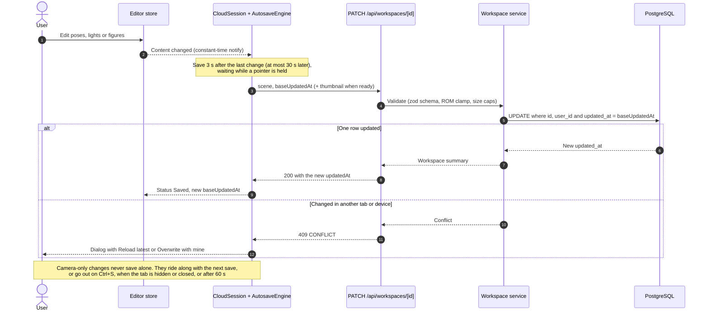

**As implemented (S4):**

| File | Role |
|---|---|
| `autosave.ts` | `AutosaveEngine` — framework-free save state machine with an injected transport (O(1) `notifyChange("content" \| "camera")`, lazy timers, no-op skip, ride-along thumbnail hook); `classifySaveError` |
| `cloud-session.ts` | `CloudSession` — binds the engine to the store (own `store.subscribe`: scene reference → content change, camera with new values → camera change; snapshot → `setPersistence`) and the browser (Ctrl/Cmd+S, `beforeunload`, `pagehide`, `online`/`offline`, `visibilitychange`, held pointers); thumbnail scheduling, conflict resolution, rename |
| `thumbnail.ts` | `renderThumbnail(capture)` via S2's `engine.capture` — 320 × 200 WebP → JPEG, quality 0.68 → 0.55 → 0.42 until ≤ 25 KB (else the smallest), bulbs and helpers hidden, checked with S3's `checkThumbnailDataUrl` |
| `scene-compare.ts` | Allocation-free comparisons for the save paths: `sameValue`, `sameContent` (all but the camera), `sameCamera`, `fitsInBytes` (UTF-8 size of ADR-021, exact only near the limit) |
| `interaction.ts` | `trackPointerInteraction` (capture-phase pointer listeners: is a pointer held?) and `runWhenIdle` (`requestIdleCallback` with fallback) |
| `cloud-editor.tsx` + `cloud-context.tsx`, `save-status.tsx`, `workspace-name-field.tsx`, `conflict-dialog.tsx`, `cloud-banner.tsx` | `CloudEditor` = `EditorLoader mode="cloud"` + `onStoreReady` + S2's slots: `toolbarLeading` (`CloudToolbarLeading`: all-workspaces link, editable name, `save-status`, `save-now`), `banner` (offline / error / paused-conflict notice), `overlays` (conflict dialog) |
| `guest-draft.ts` | Hardened guest draft (S2's `lib/guest-draft.ts` re-exports it) |
| `guest-import.ts` + `guest-editor.tsx`, `guest-import-context.tsx`, `guest-import-dialogs.tsx` | `GuestImport` flow; `GuestEditor` (rendered by `/editor`) = `EditorLoader mode="guest"` + slots: `toolbarLeading` (`GuestToolbarLeading`: draft `save-status`), `toolbarTrailing` (*Save to cloud*), `banner` (guest notice), `overlays` (sign-in choice, replace dialog) |
| `src/app/editor/[workspaceId]/{page,not-found,error}.tsx` | Cloud editor route |

- **Statuses** (`store.persistence.status` = `save-status[data-status]`): `saved` → edit → `dirty` →
  (debounce / max wait / Ctrl+S) → `saving` → `saved` (or `dirty` if edited meanwhile). Network failure
  → `offline` (backoff, plus an immediate retry on `online`); 5xx/401/unknown → `error` + backoff
  1 s, 2 s, 4 s … ≤ 30 s (± 20 % jitter); 400/413/oversized → `error` until the next change; 404 →
  `error`, stopped (Ctrl+S retries); 409 → `conflict`, stopped until the user decides. An edit that
  was undone before the save sends nothing. A camera view that is not saved yet keeps `saved` and sets
  `save-status[data-camera-pending="true"]` (tooltip: "Scene saved … the camera view is saved with your
  next edit or when you leave"); camera-only saves run quietly (no `saving`).
- **Free-tier save policy** (ADR-058; FT-06): every PATCH is a function invocation and may wake the
  database, so: 3 s debounce / 30 s max wait; no-op saves skipped (structural comparison against the
  last saved document, then the exact JSON); camera changes never save alone (canvas clicks that keep
  the view are not changes at all); thumbnails only after content changes and normally inside a scene
  save. Measured with the same scripted input (fake clock, old vs new `CloudSession`): a 10-minute
  editing session (drags, typed values, orbits, clicks, pauses) **82 → 41 PATCH** (66 scene + 16
  thumbnail-only → 35 scene + 5 scene-with-thumbnail + 1 thumbnail), a 60 s orbit-only session
  **8 → 0** (the view is saved once, 60 s after the last orbit). Production build: one edit = one PATCH
  after 3.0 s with an 8.5 KB WebP thumbnail.
- **Interaction hot paths** (P-06): a store update costs persistence two reference checks — no
  document read, serialization, storage write, allocation or timer churn per frame (timers re-check
  their due time when they fire; the guest draft and autosave defer due work while a pointer is held or
  a gesture runs, and `fitsInBytes` avoids encoding whole scenes). Toolbar slots and the banner
  re-render only on save-state transitions. Guards: unit tests count document reads, timers,
  serializations and storage writes during simulated drags, plus a React Profiler test; per update the
  old code did 1 document read + 2 timer calls, the new code 0 (store-level A/B benchmark). Chromium
  (production build, software WebGL): during 5 s gizmo drags and orbits, persistence work is now 0
  PATCH, 0 canvas encodes, 0 whole-document serializations and 0 draft writes in both modes (before: a
  save, and in cloud mode a thumbnail capture, could land mid-gesture).
- **One request lane** (ADR-029): scene saves, thumbnails and renames run one at a time and each request
  reads `baseUpdatedAt` when it starts; the returned `updatedAt` is adopted only for requests that
  carried `baseUpdatedAt`, so the editor never conflicts with its own writes while another tab's save
  always surfaces as a conflict. Size pre-check with the ADR-021 measure (`fitsInBytes`).
- **Leaving**: `beforeunload` prompt while scene changes are unsaved (not for a camera view alone);
  `pagehide` and a hidden tab send everything pending — camera included — as a `keepalive` PATCH
  (bodies ≤ 60 KB, no thumbnail); unmounting (in-app navigation) still sends pending changes (with a
  ready thumbnail, or the thumbnail alone); the toolbar's *All workspaces* link waits for the save
  first.
- **Thumbnails** (ADR-058) are best effort: captured only when no pointer is held and the scene has
  been still for 1.5 s, in an idle callback; a 409 on a thumbnail-only request is ignored (the next
  scene save reports the conflict); an image identical to the last one sent is dropped. **Never while
  a figure references an imported model** (ADR-052, §9.11 — also when this device lacks the file):
  `thumbnailsAllowed(scene)` is checked before capturing, after capturing (a model shown meanwhile
  drops the image) and before every upload (ride-along, alone, leftover on close, guest → cloud), so
  the server keeps its last mannequin-only thumbnail; scene saves continue.
- **Conflict**: the dialog opens on 409. *Reload latest* waits for the lane, `GET`s the workspace and
  loads it with `loadDocument` inside `suppressChanges` (undo history cleared), then adopts the server
  token — nothing is sent back. *Overwrite with mine* saves without `baseUpdatedAt` (kept across
  retries). Escape closes the dialog; saving stays paused, the banner and Ctrl+S reopen it.
- **Rename** (I-06): validated with S3's `WorkspaceNameSchema`; `PATCH { name, baseUpdatedAt }`; on 409
  it is retried without `baseUpdatedAt` and the old token is kept (see ADR-029). `document.title`
  follows the name.
- **Guest → cloud** (ADR-030): *Save to cloud* writes the draft, checks the session
  (`authClient.getSession()`, loaded on demand — only when S3's auth hint cookie is present, so
  anonymous guests make no `get-session` request) and, when signed out, offers sign-up/sign-in with
  `callbackUrl=/editor?import=1` (the guest notice's *Sign up* link uses it too). Before leaving it
  stores a one-time **import intent** for this tab (`sessionStorage["artikin:import-intent"]` = epoch
  ms, set by *Save to cloud* and by the sign-in/sign-up links; valid 30 min). Back on
  `/editor?import=1`, the guest editor removes the parameter (`history.replaceState`) and consumes the
  intent: **without it nothing is imported** (a crafted link, or sign-in finished in another tab → an
  info toast "choose Save to cloud"; S6 QA). With it, it waits ≤ 4 s for
  the 3D view (thumbnail) and resumes: `GET /api/workspaces` quota pre-check → `POST { scene }`
  (server default name) + best-effort thumbnail PATCH → `clearGuestDraft({ lock: true })` →
  `router.replace("/editor/<id>")`. At the limit (pre-check or a racing 409) the replace dialog lists
  the workspaces; confirming sends `PATCH { scene, thumbnail }` without `baseUpdatedAt` (explicit,
  confirmed overwrite; `thumbnail: null` drops a stale preview). Cancel or any failure keeps the draft.
- **Guest draft**: the guest editor re-checks the stored draft text in an idle callback and reports an
  invalid one (→ default scene + toast); write failures are classified (`quota` / `too-large` /
  `unavailable`) → status `error` + one toast per failure streak; `clearGuestDraft({ lock: true })`
  ignores later writes from that page (e.g. the unmount flush) until a guest editor starts again. The
  draft is serialized only when written (1 s after the last change, deferred while a pointer is held,
  ≤ 10 s; on `pagehide` / hidden tab at once) and skipped when equal to the stored one.
- **Route** `/editor/[workspaceId]`: `requireSession` (callback to the editor) → the workspace service
  (React `cache`, shared with `generateMetadata`: title = workspace name, `noindex`) → missing,
  foreign or malformed id → `notFound()` → `editor-not-found` with HTTP 404 (no `loading.tsx` in this
  segment, so the status is set before streaming; identical output for foreign and missing ids) →
  `<CloudEditor key={id}>` with `{ id, name, updatedAt, scene }` (no thumbnail in the RSC payload).
- **Test ids** beyond TEST_PLAN §6.2: `editor-workspace-name-error`, `editor-back-to-workspaces`,
  `save-banner` (`data-kind`), `save-to-cloud-dialog`, `save-to-cloud-sign-up`, `save-to-cloud-sign-in`.

## 12. HTTP API *(implemented — M2b, S3)*

All endpoints: JSON, Node.js runtime, session required (401 otherwise), ownership enforced (404 for
workspaces that do not exist **or** belong to another user).

| Method & path | Body | Success | Errors |
|---|---|---|---|
| `GET /api/workspaces` | — | `200 { workspaces: WorkspaceSummary[], limit: number }` | 401 |
| `POST /api/workspaces` | `{ name?: string, scene?: SceneDocument }` | `201 { workspace: WorkspaceSummary }` | 400, 401, **409 `WORKSPACE_LIMIT_REACHED`**, 413 |
| `GET /api/workspaces/:id` | — | `200 { workspace: Workspace }` (includes scene) | 401, 404 |
| `PATCH /api/workspaces/:id` | `{ name?, scene?, thumbnail?, baseUpdatedAt? }` | `200 { workspace: WorkspaceSummary }` | 400, 401, 404, **409 `CONFLICT`**, 413 |
| `DELETE /api/workspaces/:id` | — | `204` | 401, 404 |
| `POST /api/workspaces/:id/duplicate` | `{ name? }` | `201 { workspace: WorkspaceSummary }` | 401, 404, 409 `WORKSPACE_LIMIT_REACHED` |
| `GET /api/workspaces/:id/thumbnail?v=<updatedAt ms>` | — | `200` image bytes (`image/png`, `image/jpeg` or `image/webp`) | 401, 404 (also: no thumbnail) |

- `WorkspaceSummary = { id, name, thumbnail, createdAt, updatedAt }`;
  `Workspace = WorkspaceSummary & { scene: SceneDocument }`. `thumbnail` is the **URL** of the preview
  image (`workspaceThumbnailPath(id, updatedAt)` = `/api/workspaces/:id/thumbnail?v=<updatedAt in ms>`)
  or `null` — responses never inline the image (FT-04, ADR-057); `PATCH` bodies still send it as a
  `data:` URL.
- Error body: `{ "error": { "code": "WORKSPACE_LIMIT_REACHED", "message": "…", "details"?: {…} } }`.
  Codes: `UNAUTHORIZED`, `NOT_FOUND`, `VALIDATION_ERROR`, `PAYLOAD_TOO_LARGE`,
  `WORKSPACE_LIMIT_REACHED`, `CONFLICT`, `INTERNAL`.
- Better Auth endpoints live under `/api/auth/*` (library-defined).

**As implemented (M2b, S3)** — `src/app/api/workspaces/**` → `src/server/http.ts` →
`src/server/workspaces.ts`; shared types in `src/features/workspaces/contract.ts`, browser client in
`src/features/workspaces/api-client.ts`:
- Every response carries `Cache-Control: private, no-store` (thumbnails: see below). Every route
  exports `maxDuration = 10` (s) — requests take well under a second; a hung one is never billed for
  long (FT-03). Handlers are wrapped by `withSession()`:
  no or invalid session (or a deleted user) → `401 UNAUTHORIZED`; it also forwards Better Auth's
  `Set-Cookie` headers from the session check (refreshed cookie cache, hint cookie, deletion of a
  stale session cookie — §7); unexpected errors are answered
  `500 INTERNAL` with a generic message — never a stack trace, SQL or file path — plus an
  `X-Request-Id` header, and logged as `[api] METHOD /path failed (request <id>): <error class names>
  (SQLSTATE …)`: no messages, SQL or parameters, which can hold scenes, thumbnails or user ids
  (PROJECT §14). `<id>` is Vercel's `x-vercel-id`, else a UUID. Unexported methods (e.g. `PUT`) get
  Next.js' 405.
- Every `POST` and `PATCH` must send `Content-Type: application/json` — **also without a body**
  (S6 QA L1: a bodiless cross-site form post must not create a workspace) — else
  `400 VALIDATION_ERROR`; this is checked first. Bodies are read with a **640 KB cap before
  parsing** (declared `Content-Length` or streamed) → `413` `details: { field: "body", maxBytes }`;
  malformed JSON and non-objects → 400. `POST` bodies are optional (empty or `{}` = defaults);
  unknown keys are ignored.
- **Unread bodies are discarded before answering** (LIM-07, ADR-039). Next.js hands route handlers
  the Node request wrapped in a WHATWG `Request`, which turns off Node's automatic dump of an unread
  body: a response sent without consuming it (401, a 413 from `Content-Length`, a body cut off at the
  cap) left the bytes on the keep-alive socket until the keep-alive timeout (~5 s) reset it, so the
  client's next request on that connection failed with `ECONNRESET`. `withSession()` therefore reads
  and throws away whatever the handler left unread (`discardRequestBody`, O(1) memory) and only then
  returns the response, so the 413 arrives once the upload is received. Bodies over
  `BODY_DRAIN_LIMIT_BYTES` (8 MiB, declared or streamed) are not read to the end: they still get
  their 413, but that connection is reset afterwards. Clients must pre-check sizes (ADR-021); Vercel
  Functions refuse request bodies over 4.5 MB before they reach the app. No `Connection: close`:
  closing with unread data makes the client see a reset *instead of* the 413.
- Validation: names → `WorkspaceNameSchema` (trimmed, 1–60, no control characters); scenes →
  `parseScene(input, { clampPose })` (ADR-020: angles clamped; schema violations → 400 with
  `details.issues: [{ path: "scene.mannequins.0.name", message }]`; normalized document > 256 KB →
  `413` `field: "scene"`, ADR-021); thumbnails → `checkThumbnailDataUrl` (`data:image/(jpeg|png|webp);base64,`
  whose bytes start with the matching file signature; > 300 KB → `413` `field: "thumbnail"`; SVG,
  HTML, URLs, bad base64 → 400; `null` removes it); `baseUpdatedAt` must be an ISO date-time; a
  `PATCH` without name, scene or thumbnail → 400.
- Ids that are not UUIDs → `404` without a query; another user's workspace gets the identical 404
  body (`"Workspace not found."`).
- `409 WORKSPACE_LIMIT_REACHED` → `details: { limit, count }`; `409 CONFLICT` → `details: { updatedAt }`
  (the current token).
- Defaults: create → "Untitled workspace N" (lowest free N, default scene, no thumbnail); duplicate →
  "<name> (copy)", "(copy 2)", … (≤ 60 characters) with the same scene and thumbnail, copied inside
  the database (`INSERT … SELECT`).
- **Thumbnails by URL** (FT-04, ADR-057): `GET /api/workspaces/:id/thumbnail` decodes the stored data
  URL and answers the image bytes (owner only; the same 404 for a foreign workspace and for one
  without a preview). With `?v=` equal to the workspace's current `updatedAt` in milliseconds it
  sends `Cache-Control: private, max-age=31536000, immutable` — every update changes `updatedAt`
  and therefore the URL, so a browser fetches each version once and repeat dashboard visits
  transfer nothing; any other (or no) `v` gets the current image with `private, no-cache`. The
  dashboard (and S4's import dialog) render the URL in a plain unoptimized ``; JSON responses
  (list, create, `PATCH`, duplicate, `GET :id`) carry only the URL, so neither the database nor the
  function sends the image along (the `PATCH` response is a summary: no scene, no image).
- Reads re-run `parseScene` (migration + clamp); an unreadable stored scene → 500 (never silently
  replaced).
- For S4: on the server `getWorkspaceService().get(userId, id)` (throws `NotFoundError` from
  `src/server/errors.ts`); in the browser `workspaceApi.update(id, { scene, baseUpdatedAt }, { signal,
  keepalive })` — failures are `WorkspaceApiError` (`code` incl. `NETWORK_ERROR`, `status`,
  `currentUpdatedAt` for conflicts, `limit` for the quota). Pre-check thumbnails with
  `checkThumbnailDataUrl` (ADR-021).

## 13. Security

| Topic | Measure |
|---|---|
| Passwords | Hashed by Better Auth (scrypt); length 8–128 (client and server). |
| Sessions | DB-backed; HttpOnly, `SameSite=Lax`, `Path=/`; `Secure` + `__Secure-` prefix when `BETTER_AUTH_URL` is https (production); 30-day expiry with a daily sliding refresh; sign-out deletes the session row. A signed (HMAC) 5-minute cookie cache answers most checks without the database, so a revoked session can stay usable for up to 5 minutes (ADR-055). The JS-readable `artikin_auth=1` hint holds no data and is never trusted for authorization (ADR-056). |
| CSRF / origins | Better Auth Origin/CSRF check (forced on, `trustedOrigins` + `BETTER_AUTH_TRUSTED_ORIGINS`); every workspace-API `POST`/`PATCH` must declare `Content-Type: application/json`, even without a body (400 otherwise — no cross-site form post gets through), plus `SameSite=Lax` cookies. |
| Authorization | Every workspace query filters by `user_id`; non-owned and malformed ids → identical 404 (no existence leak); every handler is wrapped by `withSession` (401), every page calls `requireSession()`. OAuth account linking is off (ADR-041). |
| Validation | zod at every boundary (API bodies, auth forms, Better Auth profile hooks); 640 KB body cap before parsing; scene ≤ 256 KB (normalized, ROM-clamped), thumbnail ≤ 300 KB and a real PNG/JPEG/WebP data URL, names ≤ 60; open-redirect-safe `callbackUrl` (re-checked after URL normalization). |
| Rate limiting | Better Auth built-in for `/api/auth/*` with database storage, on in production (default rules: 100 / 10 s, sign-in/sign-up 3 / 10 s per IP). Client IP from Vercel's `x-vercel-forwarded-for` / `x-real-ip` on Vercel, a single-address `X-Forwarded-For` elsewhere (ADR-042). No workspace-API throttle in v1. |
| Logs | No personal data or secrets: API 500s and Better Auth log method/path, a request id and error class names + SQLSTATE only (`describeErrorForLog`); the opt-in DB query log (`DB_LOG_QUERIES=1`) prints SQL text without parameters. |
| Headers | `X-Content-Type-Options: nosniff`, `Referrer-Policy: strict-origin-when-cross-origin`, `X-Frame-Options: DENY`, CSP `frame-ancestors 'none'`, `Permissions-Policy: camera=(), microphone=(), geolocation=()`; production builds add `Strict-Transport-Security: max-age=63072000; includeSubDomains` (ADR-049; not sent by `next dev`, ignored by browsers on plain HTTP); no `X-Powered-By`; API responses `Cache-Control: private, no-store`. Full CSP with nonces is P2. |
| Secrets | `BETTER_AUTH_SECRET` (≥ 32 random bytes) and OAuth secrets only in env; `.env.local` is git-ignored; `.env.example` contains placeholders only. |
| Dependencies | `npm audit` reviewed at the release gate. |

## 14. Performance budget

| Item | Budget |
|---|---|
| Landing page JS | ≤ 160 KB gzipped initial JS incl. framework (≈ 135 KB react-dom + Next runtime), idle-time prefetch excluded; landing route-specific JS ≤ 20 KB; no three.js. (Original 120 KB target is not reachable with Next 16's runtime alone — re-baselined 2026-11-26 from S7's measurements.) Measured 2026-11-26 on the production build (`docs/brand/generator/scripts/landing-checks.mjs`): **139.1 KB** initial (8 files; was 181.9 KB before ADR-037), route-specific 5.9 KB. The root layout must stay free of client providers — anything it imports ships with every page. |
| Editor first interactive (broadband, mid laptop) | < 3 s |
| Frame rate | ~60 fps (1 figure, 1 shadow bulb) · ≥ 30 fps (4 figures, 2 shadow bulbs) |
| Autosave payload | typically < 50 KB |
| Idle GPU usage | ~0 (render on demand) |

**Editor interaction — perf pass (S2, 2026-11-26, P-01…P-05; design §9.8).** Production build
(`NEXT_PUBLIC_E2E=1`), Playwright Chromium headless shell on D3D11 WARP — software rendering on a
GPU-less VM, the slowest target and what a browser on this machine uses. The VM's 16 cores were
shared with other sessions (often 100 % CPU), so each cell pair is the baseline and the optimized
build measured back to back by the same script (70 scripted pointer moves per gesture, ≈ 60 Hz).
Hover and FK: renderer main-thread ms per pointer move (FK frame counts are not comparable — frames
only render when the joint value changes, and the baseline also re-rendered ring hovers mid-drag);
others: frames rendered per second during the gesture. At rest the image is pixel-identical (max
channel difference 0). Before → **after**:

| 1 figure + 1 shadow bulb | 1280 × 800 | 1920 × 1080 | 1280 × 800 @ 2× |
|---|---|---|---|
| Hover over the figure (main ms / move) | 13.4 → **3.3** | 13.0 → **1.8** | 15.9 → **1.9** |
| FK ring drag (main ms / move) | 21.0 → **7.7** | 22.7 → **6.0** | 27.8 → **5.8** |
| Orbit (fps) | 39 → **43** | 27 → **42** | 18 → **24** |
| Turntable (fps) | 56 → **57** | 32 → **56** | 30 → **46** |
| IK hand drag (fps) | 21 → **25** | 14 → **26** | 12 → **41** |
| Joint slider drag (fps) | 13 → **14** | 11 → **22** | 10 → **9** |
| Bulb drag (fps) | 16 → **18** | 12 → **29** | 9 → **28** |
| Long tasks, all gestures (ms) | 539 → **415** | 2 954 → **606** | 8 595 → **4 697** |
| Triangles per camera-only frame | 204 k → **33 k** | 204 k → **33 k** | 204 k → **33 k** |

| 4 figures + 2 shadow bulbs | 1280 × 800 | 1920 × 1080 | 1280 × 800 @ 2× |
|---|---|---|---|
| Hover (main ms / move) | 48.6 → **3.0** | 69.1 → **2.8** | 66.1 → **5.1** |
| FK ring drag (main ms / move) | 65.1 → **8.0** | 100.9 → **13.7** | 113.2 → **8.5** |
| Orbit (fps) | 11 → **28** | 6 → **11** | 5 → **9** |
| Turntable (fps) | 15 → **56** | 10 → **35** | 8 → **53** |
| IK hand drag (fps) | 11 → **28** | 5 → **17** | 5 → **27** |
| Joint slider drag (fps) | 10 → **17** | 4 → **10** | 5 → **16** |
| Long tasks, all gestures (ms) | 17 626 → **93** | 36 116 → **2 114** | 33 206 → **602** |
| Triangles per camera-only frame | 1 173 k → **118 k** | 1 174 k → **119 k** | 1 173 k → **118 k** |

Headless WARP lets the main thread queue frames faster than it rasterizes them, so the fps above
can overstate presented frames when the GPU side is the bottleneck. A GPU-synchronised re-run (a
1 × 1 `readPixels` after every frame, so each counted frame is rasterized; same back-to-back method)
shows the presented rate, fps before → **after**:

| Gesture | 1 + 1 · 1280 | 1 + 1 · 1920 | 4 + 2 · 1280 | 4 + 2 · 1920 |
|---|---|---|---|---|
| Orbit | 31 → **36** | 15.5 → **16** | 11 → **34** | 6.5 → **20** |
| Turntable | 30 → **58** | 15 → **43** | 10 → **30** | 6.6 → **18** |
| IK hand drag | 24 → **26** | 9 → **15** | 9 → **11** | 6 → **7** |
| Joint slider drag | 16 → **19** | 8 → **20** | 8 → **13** | 5.5 → **10** |
| Bulb drag | 17 → **25** | 6 → **27** | — | 5 → **12** |

Drags that change the pose or a light still redraw the cube shadow maps every frame (now only the
faces that contain a figure), which bounds IK / slider speed on software GL. The development server
(`npm run dev`: React development build) does up to ~2.5× more main-thread work for the same code in
drags that update panels (1280 × 800, 1 + 1: bulb drag 9.8 fps and 36 ms main per frame vs 17.9 fps
and 14 ms; slider 24 vs 15 ms) — judge smoothness on a production build. Open: a one-off 0.4–0.7 s pause at the start of an FK ring drag
on software GL, present before and after, not on the main thread (no long task); not isolated.

## 15. Testing strategy & quality gates

| Level | Tool | Scope |
|---|---|---|
| Unit | Vitest (node) | ROM/clamp/mirror/IK, presets validity, scene schema & migrations, workspace service with in-memory PGlite (limit incl. concurrent creates, ownership, conflicts), API handlers |
| Component | Vitest + Testing Library (jsdom) | Forms, dashboard cards/dialogs, editor panels (non-WebGL parts) |
| E2E | Playwright (Chromium, software WebGL) | Sign up → create → edit → autosave → reload; 5-workspace limit; lock prevents edits; guest draft; export |
| Visual | Playwright screenshots → `docs/screenshots/` | Presets, poses, lighting, key UI states (reviewed by agents & supervisor) |

Commands *(confirmed by S1 in M1)*: `npm run lint` · `npm run typecheck` · `npm test` ·
`npm run test:e2e` · `npm run build` · `npm run verify` (= lockfile:check + lint + typecheck + test +
build).
A milestone gate passes only when the relevant commands are green **and** evidence is recorded in
PROGRESS.md.

Implementation notes (M1):
- **Type checking** (ADR-013): `npm run typecheck` = `tsc -p tsconfig.typecheck.json`, which ignores
  every `.next*` dir and `next-env.d.ts` and loads Next's ambient types from
  `src/types/next-ambient.d.ts` — results do not depend on other agents' dev servers. `next build`
  skips type checking; `verify` and `vercel-build` run `typecheck`. Do not use Next's generated
  `PageProps`/`LayoutProps`/`RouteContext` helpers; type props explicitly
  (`params: Promise<{ workspaceId: string }>`).
- **Vitest** (`vitest.config.mts`, two projects): `*.test.ts` → `node`, `*.test.tsx` → `jsdom` with
  `src/test/setup-dom.ts` (jest-dom matchers + Testing Library cleanup; globals are off — import
  `describe/it/expect` from `vitest`). `@/` alias; `server-only` is aliased to a stub so server
  modules are testable. Node tests have 30 s timeouts for PGlite. DB tests: `createTestDb()` (§6.1).
- **Playwright** (`playwright.config.ts`, owned by S6 since M4): `tests/e2e`, Chromium with
  SwiftShader/ANGLE flags, `testIdAttribute: data-testid`. Unless `E2E_BASE_URL` points at a running
  localhost server, it starts the app only through the npm scripts — `npm run build && npm run start
  -- -p 3100` by default, `npm run dev -- -p 3100` with `E2E_SERVER=dev` — so the localhost binding,
  telemetry switch and network guard apply; with `NEXT_DIST_DIR=.next-e2e`,
  `PGLITE_DATA_DIR=.data/pglite-e2e`, `NEXT_PUBLIC_E2E=1` (details in the config and
  [TEST_PLAN.md](./TEST_PLAN.md)).
- Scripts also include `test:watch`, `db:generate`, `db:migrate`, `auth:generate`,
  `format -- <files>` and `vercel-build`. `dev`/`start` bind to localhost; `dev`/`build`/`start`
  disable Next.js telemetry (ADR-017) and preload the network guard (ADR-028).
- **Lockfile hygiene** (ADR-019): `scripts/normalize-lockfile.mjs` (plain Node, no dependencies;
  tests in `scripts/normalize-lockfile.test.ts`). `npm run lockfile:normalize` rewrites every
  registry-tarball `resolved` URL on another host to the canonical
  `https://registry.npmjs.org/<name>/-/<unscoped-name>-<version>.tgz` (name/version from the lockfile
  entry, aliases resolved; only those strings change, so `integrity`, formatting and line endings
  stay identical; idempotent). `npm run lockfile:check` exits 1 listing every non-public `resolved`
  URL and is the first step of `verify`. Local paths (workspace links, `file:`) are allowed; git or
  direct-tarball URLs cannot be rewritten and fail both commands. Optional argument: a lockfile path
  (`node scripts/normalize-lockfile.mjs [--check] <path>`).
- **No npm registry contact** (ADR-028): nothing in the project may contact the public npm
  registry — some networks block it and show a notification for every attempt. Next.js 16.4
  contacts it by itself in three places:
  (1) `next dev` startup and (2) `next build` when it detects a coding agent (`@vercel/detect-agent`)
  query npm security advisories for its upgrade reminders — `next.config.ts` sets
  `experimental.agentUpgrade: false`, which skips both (`next start` never queries); (3) the dev
  server's version check (`dist-tags`) on the first browser connection, which has no option —
  `npm run dev` preloads `scripts/dev-network-guard.cjs` with
  `cross-env NODE_OPTIONS="--require=./scripts/dev-network-guard.cjs $NODE_OPTIONS"` (cross-env and
  `sh` both expand `$NODE_OPTIONS`, so options the caller set are kept). `npm run build` and
  `npm run start` preload it the same way as defense in depth, which covers `verify`,
  `vercel-build` and the E2E web server. The guard (dependency-free
  CommonJS) wraps `globalThis.fetch` and `http(s).request/get`: requests to `registry.npmjs.org`,
  `registry.npmjs.com` or `registry.yarnpkg.com` fail in-process with `ERR_ARTIKIN_NETWORK_BLOCKED`
  before any DNS lookup or socket (Next.js then reports the version as "unknown"), and the first one
  per host is logged as
  `[artikin] blocked outbound request to … (Artikin network guard: public package registries are disabled in local servers)`;
  every other request reaches the original function with the same arguments. It rewrites its relative
  `NODE_OPTIONS` entry to an absolute path so Next's forked server and Turbopack's Node.js workers
  load it too. Native code (Turbopack's Rust side, e.g. `next/font` downloads) is unaffected.
  `ARTIKIN_NETWORK_GUARD_DEBUG=1` logs every blocked request and each process that loads the guard.
  Tests: `scripts/dev-network-guard.test.ts` (child processes with a socket trap, so they never reach
  the network; the `dev`/`build`/`start` prefixes run through the real shell and cross-env); static
  checks in S6's CMP-11 (`tests/e2e/compliance/npm-registry.spec.ts`).

**E2E conventions (contract between S6 and feature owners):**
- Elements that tests interact with carry a kebab-case `data-testid` named `<area>-<element>`, e.g.
  `editor-canvas`, `toolbar-lock`, `toolbar-undo`, `toolbar-export`, `save-status`, `outliner-item`,
  `bone-slider-flex`, `light-intensity`, `workspace-card`, `workspace-new`, `workspace-usage`,
  `auth-email`, `auth-password`, `auth-submit`. Prefer accessible roles/names in tests; use test ids
  for canvas-adjacent and ambiguous elements.
- Test hook: when `NEXT_PUBLIC_E2E === "1"` or in development, the editor exposes a read-only
  `window.__artikin` (deep-copied snapshots; `src/features/editor/test-hook.ts`, imported dynamically
  behind that check; `next.config.ts` `env` inlines `NEXT_PUBLIC_E2E` at build time as `"1"` or `"0"`,
  so normal production builds contain no hook chunk — SEC-04: 0 client chunks with `__artikin` — while
  E2E production builds must set `NEXT_PUBLIC_E2E=1` when building): `ready`, `getDocument()`,
  `getSelection()`, `getPersistence()`, `getHistory()` → `{ past, future }`, `getTool()`,
  `project(target)` → page CSS-pixel `{ x, y, visible }` for `{ kind: "bone" }` (a whole pixel next
  to the segment centroid whose ray meets that bone first, so a click there selects it — `click`
  events report whole pixels; not visible when no such pixel exists),
  `"joint"` (pivot), `"gizmoRing"` (a grabbable point on a ring of the shown gizmo), `"light"`,
  `"ikHandle"` (always on top) and `"world"`; `getFrameCount()`, `getRenderStats()` (draw calls,
  triangles, live geometries/textures/programs, visible meshes) and `isIdle()` (no frame pending — a
  reduced interaction resolution still on screen counts as pending, §9.8 — and no drag; more robust
  than frame-count quiet periods, because one software-rendered frame can exceed such a period). Used e.g. to prove that dragging across a locked figure leaves
  `getDocument()` unchanged.
- WebGL in headless browsers uses software rendering (SwiftShader/ANGLE). Visual assertions are
  screenshots reviewed by agents; functional assertions use DOM state and the test hook.

## 16. Configuration & deployment

### 16.1 Environment variables

| Variable | Required | Default | Purpose |
|---|---|---|---|
| `DATABASE_URL` | Production | — | Postgres connection string (Neon pooled URL) |
| `PGLITE_DATA_DIR` | No | `.data/pglite` | Local embedded DB directory (dev only) |
| `BETTER_AUTH_SECRET` | Production (dev: `.env.local`) | — | Signing/encryption secret |
| `BETTER_AUTH_URL` | Production | dev: per-request from the localhost allowlist (§7) | Public base URL |
| `BETTER_AUTH_TRUSTED_ORIGINS` | No | — | Extra trusted origins, comma-separated (e.g. Vercel preview URLs); read by Better Auth |
| `GITHUB_CLIENT_ID` / `GITHUB_CLIENT_SECRET` | No | — | Enables GitHub sign-in (read at **build** time by the prerendered auth pages too — redeploy after changing) |
| `GOOGLE_CLIENT_ID` / `GOOGLE_CLIENT_SECRET` | No | — | Enables Google sign-in (same as GitHub) |
| `MAX_WORKSPACES_PER_USER` | No | `5` | Workspace quota (the sign-up page shows the build-time value) |
| `DB_LOG_QUERIES` | No | — | `1` logs every query's SQL text (never parameters) as `[db] …` — counting queries per request locally (§6.5) |
| `NEXT_DIST_DIR` | No (agents) | `.next` | Per-agent build directory so several dev servers can run in one folder |
| `NEXT_TELEMETRY_DISABLED` | No | `1` (set by the npm scripts and `next.config.ts`) | Keeps Next.js telemetry off |
| `ARTIKIN_NETWORK_GUARD_DEBUG` | No | — | `1` makes the dev network guard log every blocked request and each process that loads it (§15) |
| `NEXT_PUBLIC_E2E` | No | — | `1` exposes the editor test hook (§15); inlined at **build** time by `next.config.ts` (`env`), so it must be set for `npm run build` — the Playwright web server does this |
| `E2E_BASE_URL` | No | — | Run E2E against an already running **localhost** server instead of starting one (other switches: `E2E_SERVER`, `E2E_SKIP_BUILD`, `E2E_SKIP_SERVER`, `E2E_FEATURES`, `E2E_RUN_ID`, `E2E_PROD_DIST_DIR`, `E2E_VISUAL`, `E2E_PERF` — TEST_PLAN §5.2) |

The template with comments is `.env.example`; `.env.local` holds local secrets (git-ignored).

### 16.2 Vercel deployment (owner, personal accounts)

**Live since 2026-11-27: <https://artikin.vercel.app>.** It runs as a Vercel Hobby project with its
functions in `sin1`. The database is a Neon Free project in `aws-ap-southeast-1`, created through the
Vercel-managed integration for the Production environment only, with a 0.25 CU compute and scale to
zero. Every push to `main` builds and deploys production. The generated deployment URLs and branch
aliases are behind Vercel Authentication, so the public uses only the production domain. That
domain is also the only origin Better Auth accepts (`BETTER_AUTH_URL`).

Step-by-step guide with the free-plan limits, what happens when one runs out and where to watch
usage: README → "Free hosting (Vercel Hobby + Neon Free)". In short:

1. The repository is on the owner's personal GitHub account; every push to `main` deploys.
2. Import the repository in Vercel (**Hobby**; framework preset Next.js). Build command
   `npm run vercel-build` (typecheck → migrations → `next build`); Node.js 22+.
3. Add **Neon** from the Vercel Marketplace (Free plan, region `aws-ap-southeast-1`), connected to
   **Production** only — it injects the pooled `DATABASE_URL`. Neon autoscaling max 0.25–0.5 CU
   (Neon console → Postgres database → Computes → Edit), scale to zero on (100 CU-hours a month ≈
   400 h awake at 0.25 CU).
4. Set `BETTER_AUTH_SECRET` (a new random value) and `BETTER_AUTH_URL=https://<domain>`. Optional
   OAuth: callback URLs `https://<domain>/api/auth/callback/github` and `/google`.
5. Already in the repository: `vercel.json` pins functions to `sin1` next to the database,
   `images.unoptimized` (no image transformations), HSTS in production, PGlite left out of function
   bundles (ADR-048…050). Preview builds stop at `db:migrate` without a Preview database — on
   purpose, previews never migrate production; skip them with the Ignored Build Step "Only build
   production".

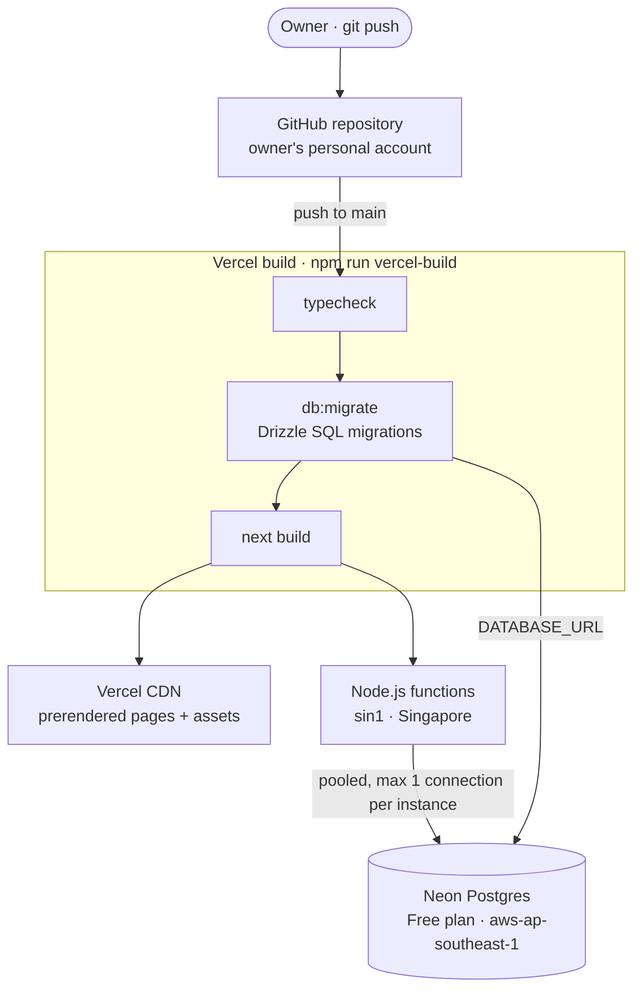

## 17. Decision log (ADR)

| ADR | Decision | Rationale | Status |
|---|---|---|---|
| 001 | Next.js App Router hosted on Vercel | Owner requires Vercel; first-class support, RSC, Route Handlers | Accepted |
| 002 | three.js via R3F + drei | Mature ecosystem; declarative scene; ready-made controls/gizmos | Accepted |
| 003 | Procedural mannequin (no external model files) | License-clean, parametric proportions for presets, tiny download | Accepted |
| 004 | VRM 1.0 humanoid bone names as joint IDs | Future VRM avatar import maps 1:1 | Accepted |
| 005 | Per-axis Euler limits in degrees, rest = neutral standing pose | Predictable sliders/clamping; human-readable documents | Accepted |
| 006 | Better Auth 1.7 (stable) for auth | Auth.js is now maintained by the Better Auth team; no vendor lock-in (vs Clerk); Drizzle adapter | Accepted |
| 007 | Drizzle + Postgres (Neon) in production, PGlite locally/tests | Zero-install development with the same dialect; serverless-friendly | Accepted |
| 008 | Workspace limit in a transaction with a per-user row lock; configurable | Correct under concurrency; "5 for now" | Accepted |
| 009 | Scene stored as versioned JSONB document | Flexible evolution, single read/write per save | Accepted |
| 010 | Multi-agent development in one shared folder without git | Owner: no commits/pushes; mitigated by ownership areas, per-agent `NEXT_DIST_DIR`/port/PGlite dir and an npm lock (AGENTS.md) | Accepted |
| 011 | No copyrighted characters; generic anime age/build presets + toon material | IP compliance for a public app | Accepted |
| 012 | `cacheComponents` **off** (create-next-app 16.4 enables it with `partialPrefetching`) | Classic dynamic rendering keeps auth/DB pages simple for parallel agents: no Suspense around every `headers()`/DB read, no build-time "uncached data" errors, no `use cache` rules to learn. Next.js plans to make it the default in the next major → revisit on upgrade | Accepted (S1) |
| 013 | Deterministic type checking: `npm run typecheck` = `tsc -p tsconfig.typecheck.json` (ignores `.next*` and `next-env.d.ts`, stable ambient types in `src/types/next-ambient.d.ts`); `next build` skips type checking (`typescript.ignoreBuildErrors`); `verify` and `vercel-build` run `typecheck` first | Next rewrites `tsconfig.json`/`next-env.d.ts` for whichever dist dir ran last, and `next build` type-checks everything `tsconfig.json` includes — other agents' stale `.next*/types` would break builds. Trade-off: no generated `PageProps`/`LayoutProps`/`RouteContext`; type props explicitly | Accepted (S1) |
| 014 | Lazy, migration-gated DB client: importing `@/lib/db` has no side effects; PGlite opens on the first query and applies migrations before any query runs; it refuses to open during `next build` | Safe for parallel build workers and for tooling that imports the auth config (Better Auth CLI, drizzle-kit); local auto-migrate without an extra step | Accepted (S1) |
| 015 | `agentRules: false` in `next.config.ts` | `next dev` otherwise writes a managed block into AGENTS.md on every start; AGENTS.md is supervisor-owned and many dev servers start concurrently | Accepted (S1) |
| 016 | shadcn/ui CLI 4.23 style `radix-nova` (Radix primitives, compact sizing), class merging from the `cn` package; dark theme forced with `<html class="dark">`, neutral grays + one amber accent | Matches "Radix primitives" (§2); compact controls suit the dense editor UI; brand tuning belongs to S7 | Accepted (S1) |
| 017 | Compliance defaults: servers bind to localhost (`next dev/start -H localhost`, Playwright `--hostname localhost`), Next.js telemetry off (`NEXT_TELEMETRY_DISABLED=1` via `cross-env` in scripts + `next.config.ts`), Better Auth telemetry off, `package-lock.json` `resolved` URLs normalized to `https://registry.npmjs.org/` | Owner's rule (AGENTS.md "Compliance & safety"): localhost only, no telemetry, no environment-specific URLs in project files. npm still fetches through the configured registry/proxy (`replace-registry-host`) | Accepted (S1) |
| 018 | License policy: permissive licenses allowed (MIT, Apache-2.0, BSD, ISC, 0BSD, BlueOak-1.0.0, Unlicense, CC0-1.0, Python-2.0, CC-BY-4.0 data); MPL-2.0 only as unmodified dependencies (`lightningcss` for Tailwind 4, `axe-core`); LGPL only inside unmodified optional prebuilt binaries (`@img/sharp-*`); GPL/AGPL/SSPL/unknown forbidden | S6/S1 scans found no GPL/AGPL; the listed exceptions are standard, unmodified, non-distributed build/runtime dependencies. Q-09 re-audits at release | Accepted (Supervisor) |
| 019 | Keep the development environment's npm registry configuration; every install is followed by `npm run lockfile:normalize` (rewrite `resolved` hosts to `registry.npmjs.org`), and `verify` fails if non-public hosts remain | This development environment reaches packages only through its configured registry/proxy; project files must not embed non-public URLs; integrity hashes are unchanged, so installs anywhere else (including Vercel) use the public registry | Accepted (Supervisor) |
| 020 | Out-of-range pose values are **clamped, never rejected**: `parseScene` with the ROM clamp hook runs on every read and write (client and server); only structural/schema violations return `400 VALIDATION_ERROR`. `rom.ts` limits/clamp must be pure TypeScript (no three.js import) so the server can use them | Tampered or legacy data is repaired instead of failing; the client clamps anyway, so honest users never see a difference | Accepted (Supervisor) |
| 021 | Size limits: request bodies are capped at 640 KB before JSON parsing (`413 PAYLOAD_TOO_LARGE`); the scene limit (256 KB) is the UTF-8 byte length of the normalized `serializeScene` output; the thumbnail limit (300 KB) is the byte length of the data-URL string; the client pre-checks with the same functions | Unambiguous, testable limits (S6 Q12); protects memory before parsing | Accepted (Supervisor) |
| 022 | Brand and landing: "measurement plate" visual language (claims shown as measured annotations), app theme tokens reused (amber `--primary` is the only accent), Archivo (OFL, `next/font`) for landing display headings only, Geist for UI, Geist Mono for measured values; all brand imagery generated from code (`docs/brand/generator`); web art uses no SVG filters, and the hero art is inlined in the page (generated `hero-svg.ts`) rather than loaded as an image | Distinct, product-specific identity without a second palette; one font family in the app UI; license-clean and reproducible assets (owner's compliance rule); filters are costly to rasterize on phones, and inline art paints with the first frame so the LCP element is the hero heading (mobile Lighthouse LCP 3.1–3.6 s → 1.2 s) | Accepted (S7) |
| 023 | ~~Landing `/` renders per request (reads the session) instead of being prerendered~~ — **superseded by ADR-043** (static landing + client auth islands) | The header and calls to action must match the visitor (Sign up vs My workspaces) without shipping the auth client or flashing; visitors without a session cookie never reach the database | Superseded (S7) |
| 024 | Workspace API shape: the service (`src/server/workspaces.ts`) is the only module touching `workspace` and validates untrusted input itself (zod + `parseScene`); route handlers are thin and wrapped by `withSession` (401 JSON, never a redirect, `Cache-Control: private, no-store`); malformed ids → 404 without a query; non-JSON bodies → 400 (no 415 code, TEST_PLAN Q10) | One set of rules for the API and server pages (S4's editor load); no existence leaks; JSON-only bodies plus `SameSite=Lax` keep cross-site form posts out | Accepted (S3) |
| 025 | The concurrency token moves strictly forward on the database clock: `updated_at = greatest(clock_timestamp(), updated_at + 1 ms)` | Two saves within one millisecond would otherwise share a token and defeat `409 CONFLICT`; database time avoids app-server clock skew | Accepted (S3) |
| 026 | Auth hardening on Better Auth defaults: default rate-limit rules kept (database storage, on in production), Origin/CSRF check forced on (`advanced.disableOriginCheck: false`), profile hooks bound name/image, OAuth errors → `/sign-in?error=`, `createAuth()` factory for integration tests | S6's E2E relies on the default limits; tests exercise the real CSRF defence; external input bounded at the boundary | Accepted (S3) |
| 027 | Dashboard mutations call the JSON API through the typed client with React 19 `useOptimistic` + `router.refresh()` (no Server Actions); **New** creates and opens `/editor/<id>` (J4, TEST_PLAN Q8) | One API for the dashboard and the editor's autosave (S4); the server stays the source of truth; instant feedback without flicker | Accepted (S3) |
| 028 | Next.js never contacts the public npm registry: `experimental.agentUpgrade: false` in `next.config.ts` (no security-advisory/upgrade check at `next dev` start or in agent-run `next build`), and `npm run dev` preloads `scripts/dev-network-guard.cjs` (`NODE_OPTIONS=--require`, inherited by Next's child processes; `build` and `start` preload it too as defense in depth, keeping the caller's `NODE_OPTIONS`), which fails `fetch`/`http(s)` requests to the npm/Yarn registry hosts in-process and logs one line per host (§15) | Some networks block the public registry and show a notification for every attempt, this development environment's among them (AGENTS.md "Compliance & safety"); the advisory check is on by default and Next detects coding agents; the dev version check (`dist-tags`, first browser connection) has no opt-out. The config switch removes requests at the source, the guard covers what cannot be switched off | Accepted (S1) |
| 029 | Editor saving uses **one request lane** per open workspace: scene saves, thumbnails and renames run one at a time, each built when it starts with the latest `baseUpdatedAt`; a returned `updatedAt` is adopted only when the request carried `baseUpdatedAt`. Thumbnails are best effort (409 ignored); a rename that hits 409 is retried last-write-wins **without** adopting the token | The editor never conflicts with its own writes, while a save from another tab/device always surfaces as `409 CONFLICT` on the next scene save instead of being silently overwritten | Accepted (S4) |
| 030 | Guest → cloud resumes on the public guest page: sign-up/sign-in return to `/editor?import=1` (no extra route); the guest editor checks the quota with `GET /api/workspaces` before `POST`, keeps handling a racing `409 WORKSPACE_LIMIT_REACHED`, replaces a chosen workspace with an explicit PATCH without `baseUpdatedAt`, and clears the draft only after the upload succeeded. **Amended (S6 QA):** `?import=1` imports only with a one-time, 30-minute import intent that the same tab stored in `sessionStorage` when the guest chose *Save to cloud* (or the notice's *Sign up*); consumed on use, cleared after an import | The draft lives in that page's localStorage and 3D view (thumbnail); the proxy keeps `/editor` public; no failing request (console error) in the usual at-limit case; the draft is never lost on errors or cancel. The intent stops a crafted link from turning a signed-in visitor's draft into a workspace (sessionStorage is per tab and survives the sign-in redirects) | Accepted (S4) |
| 031 | One **rigid-skinned `SkinnedMesh` per figure**: every vertex carries exactly one bone index; picking reads the hit triangle's `skinIndex`; `geometry.parts` lists the segment → bone vertex ranges (PROJECT §7.3) | One draw call per figure (+6 per shadow bulb) instead of ~70 meshes; one shared skeleton for the toon outline and the shader highlight; the mapping stays testable without per-mesh `userData` (MAN-03 checks `parts`) | Accepted (Supervisor, S2) |
| 032 | Custom **semantic gizmo rings** instead of drei `TransformControls`: one ring per unlocked DOF, oriented by `rom.dofMotion`, values clamped by `clampDof`; IK = CCD over the same semantic DOFs with an analytic elbow/knee step | A ring changes exactly one anatomical DOF, so limits never fight a generic rotate gizmo (no jitter at the limit); locked DOFs cannot be dragged; FK, IK, sliders and presets share one encoding | Accepted (S2) |
| 033 | Shoulder ball joint (`*UpperArm`) parametrized by **swing-twist (exponential map)**; hips (`*UpperLeg`) by Euler flex → side → twist; other joints Euler with the unused axis in the middle | Euler shoulders gimbal-lock at the T-pose; the hip's gimbal (90° abduction) lies outside its range and Euler keeps large hip twists (cross-legged, kneeling presets) predictable | Accepted (S2, with S5) |
| 034 | Lock flags are saved with the scene but are **not undo steps**; history snapshots are rewritten to the current lock flags and undo/redo of a step touching a locked item is refused with a toast | Undo must never unlock (PROJECT §10, LOCK-09) and locking must not consume history | Accepted (Supervisor; PROJECT F8 updated) |
| 035 | Point-light shadows: `<Canvas shadows="percentage">` plus a one-time patch of three's point-shadow chunk to 12 fixed Vogel taps (`scene/shadow-sampling.ts`, unit-tested, no-op if the chunk changes); normal bias scaled by softness and shadow-map texel size | three r187 removed `PCFSoftShadowMap` and samples 5 noise-rotated taps meant for TAA, which shows as stippled grain on curved bodies without TAA | Accepted (S2) |
| 036 | Scene contract: optional proportion overrides `handSize` and `footSize` (0.75–1.25 ×) added to `PROPORTION_KEYS` / `ProportionOverridesSchema` | Body presets need an extremity scale independent of height; additive and backward compatible | Accepted (Supervisor) |
| 037 | No client providers in the root layout: `<Toaster>` is mounted by `(app)/layout.tsx` (dashboard, account menu) and `editor/layout.tsx`, `<TooltipProvider>` only by `editor/layout.tsx` (the only tooltip users). A layout must mount a provider before its pages use `toast()` or `Tooltip` (the shadcn `Tooltip` throws without a provider; a toast with no mounted `<Toaster>` is silently dropped) | Everything the root layout imports ships with every page: sonner, Radix Tooltip/popper and their wrappers cost the landing ≈ 43 KB gzip — initial JS 181.9 → 139.1 KB (PROJECT §3.3: ≤ 160 KB). The code now loads with the routes that use it (idle-time prefetch from the landing) | Accepted (Supervisor, S1; S7's options a + b) |
| 038 | Pose presets are plain joint angles tuned and tested on the **real engine** (FK + skinned mesh, `presets/pose-analysis.ts`): intended floor contacts, centre of mass inside the support, no deep self-intersection, hand targets — on the default body, and contacts/balance/intersection on all 9 body presets. Hands resting on the legs (sit on chair, sit cross-legged, kneel) are exact on the default body only; preset previews in the panel are SVG generated from the same FK | Data-only presets stay small, deterministic and clampable (ADR-020); one fixed set of angles cannot keep hand contacts on bodies with a much shorter torso (long-legged anime presets) — fitting those contacts with IK after applying a preset is a possible follow-up. Generated previews never drift from the data and need no image assets (ADR-003) | Accepted (S5) |
| 039 | Route handlers discard unread request bodies before answering: `withSession()` reads and throws away (O(1) memory) whatever the handler left unread, up to 8 MiB (`BODY_DRAIN_LIMIT_BYTES`), then returns the response; larger bodies are left unread (413 still sent, connection reset afterwards); no `Connection: close` | Next.js wraps the Node request in a WHATWG `Request`, which disables Node's own dump of unread bodies — early answers (401, 413) left bytes on keep-alive sockets that were reset ~5 s later, failing the next request with `ECONNRESET` (LIM-07; reproduced on plain Node 26 without Next). Draining keeps connections reusable; `Connection: close` with unread data makes clients see a reset instead of the 413; the limit bounds the work per request | Accepted (S3) |
| 040 | Tailwind class detection skips folders that tools write: `src/app/globals.css` declares `@source not` for `docs/`, `test-results/`, `playwright-report/`, `.data/` and `.next*` (paths relative to the stylesheet). Class names must live in scanned files (`src/`); a class written only inside an excluded folder is not generated | `@tailwindcss/turbopack` registers every scanned file (`addDependency`) and folder (`addContextDependency`) with Turbopack, which re-reads them on every change; screenshots written into `docs/` while dev servers ran crashed Turbopack with "os error 32". `docs/` added 21 watched files and a watched folder; the other four were already skipped through `.gitignore` (Tailwind honors it even without a git repository) and are now excluded explicitly. The generated CSS lost only `.container` and `.invisible`, which came from Markdown prose and are not used by the app | Superseded by ADR-047 |
| 041 | OAuth **account linking is off** in v1 (`account.accountLinking.enabled: false`): an OAuth sign-in whose email already has an account is refused (`/sign-in?error=account_not_linked`) instead of being linked | Password sign-ups are not email-verified, so linking by email would let someone who registered a victim's address first take over the victim's later OAuth sign-in (account pre-hijacking, S6 QA M2). Re-enable together with email verification | Accepted (Supervisor, S3) |
| 042 | Rate-limit client IP per platform (`getClientIpHeaders`): on Vercel only `x-vercel-forwarded-for` / `x-real-ip`; elsewhere Better Auth's default single-address `X-Forwarded-For` | Vercel's edge sets these headers to the connecting client's address and replaces client-sent values, so spoofed `X-Forwarded-For` values cannot open fresh buckets there (S6 QA L2). Off Vercel the default only holds behind one overwriting proxy — local E2E relies on it to simulate client IPs; other hosts must configure their own trusted header or `trustedProxies` | Accepted (Supervisor, S3) |
| 043 | The landing `/` and every `(marketing)` page are **prerendered**: no `getSession()` / `cookies()` / `headers()` on the server, enforced by `export const dynamic = "error"` in `(marketing)/layout.tsx`. Signed-in chrome comes from client islands (`AuthSwitch`, `HeaderAuthSwitch`, `src/components/auth-switch.tsx`) that read the non-HttpOnly hint cookie `artikin_auth` (contract and parser: S3's `src/lib/auth/auth-hint.ts`; set and cleared by the auth server, PROGRESS FT-02) through `useSyncExternalStore` with a "signed out" server snapshot. The account menu fetches the user (`authClient.getSession()`) only when it is opened and turns a stale hint into "Sign in" (that session check clears the cookie server-side; the island announces it and moves focus). Site-chrome links to routes that run server code (`/sign-in`, `/sign-up`, `/workspaces`) do not prefetch. Supersedes ADR-023 | Free hosting (PROGRESS M4c, Vercel Hobby + Neon Free): anonymous visits are served from the CDN with 0 function invocations and 0 DB queries, and no prefetch of a dynamic or proxied route turns into an invocation. Trade-offs: signed-in visitors see the visitor header/CTAs until hydration (no wrong data, no layout shift), the hint can be stale until the menu is opened, and the workspace quota on the page is fixed at build time (env changes need a redeploy anyway) | Accepted (S7) |
| 044 | **Shadow maps are cached** (`shadowMap.autoUpdate = false`) and redrawn only when a signature of shadow casters and lights changes, computed in `scene.onBeforeRender` after the matrix update (`scene/shadow-signature.ts`) | Point-light shadows redraw every caster into six cube faces per light — 6/7 of all triangles per frame with one bulb. A signature check sees every change whatever code made it (store, undo, presets, rebuilds), without a list of invalidation call sites to keep in sync; camera moves, turntable, hover and selection never pay for shadows. Cost: ~0.1 ms per frame to build the signature |
| 045 | **Rigid-skin picking and pose-aware bounds** (`mesh/rig-picking.ts`): per-bone bind-space raycast instead of three's CPU-skinned `SkinnedMesh.raycast`; bounding sphere refit after every pose / transform change; R3F hover raycasts skipped while a drag or orbit holds the pointer | three skins three corners of every triangle per raycast (~90 k transforms per figure per pointer move: 50–450 ms main-thread frames on the slow target). With one bone per vertex the exact same nearest hit needs one matrix per bone plus the triangles behind a per-bone box. Exact triangles rather than proxy capsules keep the selected segment identical to what is drawn (MAN-03/04). The tight sphere also culls empty shadow cube faces |
| 046 | **Adaptive resolution + "Rendering quality" as a per-device view preference** (localStorage `artikin:prefs:v1`, Auto / High / Balanced / Low), not in the scene document; pixel ratio set per frame in a frame callback, not via R3F's `dpr` | Quality is a property of the device (GPU), not of the scene; storing it in workspaces would push a weak laptop's setting onto a desktop. R3F re-applies its own `dpr` on Canvas re-render and resizes outside the render task (one blank frame), so the ratio is applied right before each render. Auto keeps the rest image identical to before (pixel-identical screenshots) and only lowers resolution while the view moves, guided by measured frame intervals; MSAA cannot change without recreating the context, so only Low turns it off |
| 047 | Tailwind scans **only `src/`** for class names: `@import "tailwindcss" source("../../src")` in `src/app/globals.css` (path relative to the stylesheet) replaces ADR-040's `@source not` list. A class name written only outside `src/` is not generated | Fewer files and no folders outside `src/` watched by Turbopack (309 → 225 files), so tools writing anywhere else (docs, screenshots, test reports, local databases, build output) cannot trigger "os error 32" reloads any more, and new folders need no new exclusion. The CSS lost only 4 selectors from text outside `src/` (`container`, `filter`, `running`, `[db:migrate]`), none used by the app: DOM classes identical on 7 pages, screenshots pixel-identical | Accepted (Supervisor, S1) |
| 048 | **Free-tier hosting defaults:** `images: { unoptimized: true }`; `vercel.json` `"regions": ["sin1"]` (functions in Singapore) with the Neon database in AWS `ap-southeast-1`; Neon autoscaling max 0.25–0.5 CU with scale to zero; database connected to Production only (README "Free hosting") | Vercel Hobby includes 5,000 image transformations a month and our images (SVG, data-URL thumbnails) gain nothing from optimization; with `unoptimized` the images manifest disables `/_next/image` (404 locally), so not even crafted URLs spend the quota. `sin1` is the closest region to Vietnam and sits next to the database, which every function request queries several times. Neon Free's 100 CU-hours last ≈ 400 h at 0.25 CU against 720 h in a month, so the database must sleep when idle; Preview builds without a database stop at `db:migrate` instead of migrating production | Accepted (Supervisor, S1) |
| 049 | **HSTS in production builds:** `Strict-Transport-Security: max-age=63072000; includeSubDomains` on every response when `next.config.ts` is evaluated with `NODE_ENV=production` (`next build` / `next start`); `next dev` does not send it; no `preload` | S6 final QA. Two years is the usual recommendation; `preload` would be a hard-to-undo commitment for a domain the owner has not chosen yet. Browsers ignore HSTS on plain-HTTP responses, so local `npm run start` and E2E on `http://localhost` are unaffected | Accepted (Supervisor, S1) |
| 050 | **PGlite only without `DATABASE_URL`:** all PGlite imports live in `src/lib/db/pglite.ts`, which `client.ts` loads through a conditional top-level `await import("./pglite")` (no `DATABASE_URL`, no `VERCEL=1`); with `VERCEL=1`, `next.config.ts` adds `outputFileTracingExcludes` for `node_modules/@electric-sql/pglite/**` and Turbopack's `<distDir>/node_modules/@electric-sql/pglite-*` link | Turbopack traced the whole package (187 files, incl. WASM and extension archives) into all 8 database functions although production never uses it (S6 Q-06). Static imports would crash at module load once the files are excluded (`drizzle-orm/pglite` imports the package at its top level), hence the dynamic import; the exclusion is Vercel-only because a local `npm run start` without `DATABASE_URL` runs on PGlite. Turbopack applies the option natively (Next's JS trace step is skipped for Turbopack). Verified: Vercel-mode build → 2.6–3.3 MB traced per database function instead of 22.0–22.6 MB, 0 package files; a module-resolution probe saw no `@electric-sql` module in a production server with `VERCEL=1` + `DATABASE_URL`, and saw PGlite load without them | Accepted (Supervisor, S1) |
| 051 | Dark theme **`--destructive: oklch(0.835 0.09 22)`** (#feb2af), one pale red for destructive text and tints (`text-destructive` on `bg-destructive/10…/30`); the light-theme token is unchanged (the app forces dark) | WCAG AA 4.5:1 for destructive text on every surface: the former `oklch(0.704 0.191 22.216)` (#ff6467) gave 4.24:1 on a resting dialog-footer button (S6 a11y) and ≈ 3.5:1 hovered. Measured in Chromium on the production build: hovered alert-dialog button 4.72:1 (worst case), resting 6.07:1, destructive menu item 10.42:1 / highlighted 6.66:1, auth error box 8.58:1, field error 10.42:1. Changing the shared token keeps shadcn's generated components untouched; toasts use popover colours (no `richColors`) | Accepted (Supervisor, S1) |
| 052 | **Imported models stay on the device** (PROJECT §18, v1.1): the scene stores only `model { source: "local", id: SHA-256, name, format }`; the file lives in the browser's IndexedDB (`artikin-models`), is never uploaded, and `parseScene` strips any other key inside `model`. Nothing rendered from it is uploaded either: no workspace thumbnail is sent while any figure has `model` set (local PNG export stays allowed). A device without the file shows the procedural mannequin (pose kept, missing-file notice, re-import); the model's measured proportions are merged into the figure at assignment so that fallback has roughly the model's size | Owner's compliance rule (no third-party content on servers, no uploads) and the copyright policy (PROJECT §15: users import only models they have rights to, privately); the content hash makes the same file resolve on every device without any server; cloud workspaces and guest drafts need no schema bump (additive field) | Accepted (Supervisor, S8) |
| 053 | **Retargeting with world-space rest deltas onto the model's raw bones** (`lib/model-import/analysis.ts`, `retarget.ts`) — not three-vrm's normalized rig: per mapped bone a rest delta N (model rest pose → Artikin's neutral pose; arms down with palms to the thighs, straight fingers, thumb rest direction, feet forward; torso/head keep the model's posture), an exact Artikin `SkeletonLayout` measured on the model, and node rotation = (A·A0⁻¹)·N·R0. Missing optional bones get zero-length (neck, shoulder), folded (chest → spine node) or synthesised (fingers, toes) joints | One code path for VRM 1.0, VRM 0.x and Mixamo-style GLB (any rest pose, unit, facing or bone-frame convention); the semantic pose, ROM limits, presets, mirror and undo stay the only source of truth; FK/IK/grounding/picking use the model's real joints, so handles sit on the visible model (verified: joints equal Artikin FK within 1e-6 m) | Accepted (S8) |
| 054 | **Model files are parsed from memory only and can never trigger a download**: external `uri`s refused before parsing, a loading manager that allows only `blob:`/`data:` URLs, Draco and KTX2 refused (their decoders would be fetched), meshopt supported with three's bundled decoder; three-vrm and the glTF loader load on demand (dynamic import) | Owner's rule (no network use beyond npm/fonts; nothing may leave or enter the machine for a model) and the free-tier/performance budget (the editor's initial bundle does not grow); files from any tool export embedded resources as GLB/VRM | Accepted (S8) |
| 055 | **Session cookie cache (5 min) and rate limiting only where it matters:** `session.cookieCache` (signed `session_data` cookie, Max-Age 300, no `refreshCache`); DB-backed rate limiting only on sign-in, sign-up and password/email endpoints (`RATE_LIMIT_RULES`, built-in limits kept, `"/**": false`); the browser client never refetches the session on focus | Free hosting (M4c): without the cache every page render, API call and session check read session + user (2 queries) and every `/api/auth/*` request read and wrote `rate_limit` (2 more). Measured: dashboard 12 → 1 query, sign-in → dashboard 20 → 6–9. Trade-offs: a revoked session stays usable for up to 5 minutes; Server Components cannot renew the cache, so after 5 idle minutes the next page render reads the session again (2 queries) until an API or auth response refreshes the cookie | Accepted (Supervisor, S3) |
| 056 | **Prerendered `/sign-in` and `/sign-up` + auth hint cookie:** the proxy (cookie presence only, matcher `/workspaces/:path*`, `/editor/:id`, `/sign-in`, `/sign-up`) sends visitors with a session cookie to the sanitized destination; the forms read `?callbackUrl`/`?error` in the browser; `dynamic = "error"` in `(auth)/layout.tsx`. The `sessionHint()` Better Auth plugin keeps `artikin_auth=1` (JS-readable, no PII, Max-Age = session expiry) in step with the session cookie, and `GET /api/auth/session-expired` clears a session cookie the server rejects (reached from `requireSession()`) | Anonymous visitors to the auth pages and the landing (ADR-043) cost no function render and no query; the hint lets static pages show signed-in UI. An optimistic "already signed in" redirect loops with the page's real check when the cookie is stale (revoked session, rotated secret, reset database) — Server Components cannot delete cookies, so the redirect goes through an auth endpoint that verifies with the database first (never logs out a valid session, no CSRF logout). OAuth buttons and the quota text are build-time values | Accepted (Supervisor, S3) |
| 057 | **No images or scenes in summary responses; serverless DB pool:** `WorkspaceSummary.thumbnail` is the URL `/api/workspaces/:id/thumbnail?v=<updatedAt ms>` (private, `immutable` for the current version); list/create/update/duplicate select `thumbnail IS NOT NULL`, never the image or scene; duplicate copies inside the database (`INSERT … SELECT`); postgres.js `max: 1`, `idle_timeout: 20`, `max_lifetime: 300`; `maxDuration = 10` on API routes; dashboard card links do not prefetch the editor | Neon Free allows 5 GB egress and Vercel Hobby 100 GB transfer a month: two 35 KB thumbnails made every dashboard render 120 KB (database → function → browser, twice in the HTML), now 13 KB plus a one-time image download per version; each autosave `PATCH` no longer reads back up to 300 KB. One short-lived connection lets Neon scale to zero. The editor-link prefetches ran the cloud editor (3 queries) per card per dashboard view | Accepted (Supervisor, S3) |
| 058 | **Free-tier save policy** (cloud editor, §11): content changes save 3 s after the last change and at most 30 s after the first unsaved one; a due save waits while a pointer is held (never past the 30 s); no-op saves are skipped (structural comparison, then the exact JSON). **Camera-only changes never save alone**: they ride along with the next scene save or go out on Ctrl/Cmd+S, when the tab is hidden or closed (keepalive) or after 60 s without changes, and they don't count as unsaved (status stays *Saved*, `save-status[data-camera-pending]`, no `beforeunload` prompt). **Thumbnails** only after content changes, at most every 120 s, made once the scene is still (1.5 s, no drag): 320 × 200 WebP (JPEG where WebP can't be encoded), quality 0.68 → 0.42 aiming at ≤ 25 KB; a ready one rides along with the next save (a save never waits for it), goes alone only after 30 s without changes (in the same request as a pending view) or when the editor closes, and never when the image is unchanged | Each PATCH is a Vercel function invocation and may wake the Neon compute (owner: free hosting). Same scripted input with a fake clock: a 10-minute editing session 82 → 41 PATCH (66 scene + 16 thumbnail-only → 35 scene + 5 scene-with-thumbnail + 1 thumbnail), a 60 s orbit-only session 8 → 0. Production build in Chromium: one edit = one PATCH 3.0 s later carrying an 8.5 KB WebP; Ctrl+S sends within 4 ms. Ctrl+S keeps saving the view so an explicit save is complete and tests can make camera persistence deterministic | Accepted (S4) |
| 059 | **View lock** (owner request): `lock.view` (additive, default `false`) joins the scene locks; the master lock (`L`, toolbar button) = pose + lights + view, the lock menu and `V` toggle the view alone. Locked = no orbit/zoom/pan input (`enableRotate/Zoom/Pan`, not `enabled`), camera commands refused in the store, the angle on screen at lock time saved and held every frame | Artists draw from one fixed angle; an accidental orbit while sketching loses it. Refusing in the store (last line of defence) and disabling the input closes every path; holding the stored camera every frame (as a fixed point of OrbitControls' limits) keeps the view exact across damping tails, resizes and reloads. Locks stay a saved, non-undoable mode (ADR-034) | Accepted (S2; PROJECT F6 by the supervisor) |
| 060 | **Framing and auto framing** (supervisor G2 review: "the default view (and Frame selection/view presets) should show the whole figure head-to-toe with a comfortable margin, including the floor contact/shadow … fit the figure's bounding box (respecting focal length)"): an exact fixed-direction frustum fit of point sets (`lib/framing.ts`) for the current lens and canvas aspect — figures + floor contact with an 8 % margin, bulbs 36 px inside the edges and clear of the camera views cluster; presets frame all visible figures, `F` the selection. A camera at the factory placement means "never moved": the editor frames the scene for the canvas and lens it is shown with and re-frames on resize / lens change, without saving, until the user moves the camera | A fixed default camera cannot fit every aspect ratio and focal length (and an older, closer default cropped the feet); saving the fitted view on open would create a camera-only change for every fresh workspace (autosave, COST-04) and pin one device's framing for all others. The placement doubles as the "auto" marker, so the document contract is unchanged | Accepted (S2) |
| 061 | **Sculpted faces per body preset** (owner request 2026-11-27: "add a nose and eye sockets to the mannequin … also add lips; each existing model gets its own style of eye sockets, nose and mouth, for male and female models"): nine generic face styles as data (`mesh/face.ts`, `FACE_STYLE_BY_PRESET`), carved as a C1 relief on the egg head's front along +Z on a non-uniform mirror-symmetric 56 × 52 grid (`mesh/head.ts`, grid-derived normals); the figure-model key includes the face style; toon shading reads separate `toonNormal`s (egg + broad forms) plus a per-vertex `toonCavity` drawn in the shadow tone (lid creases, nostrils, lip line), and the outline skips face creases | Real geometry (not paint) is what makes a bulb cast form and cast shadows in the sockets and under the brow, nose and lips — the point of light study. A +Z heightfield cannot fold, keeps the head height (BODY-01 heads tall) and keeps rigid skinning (every face vertex on `head`); a feature-focused grid keeps the triangle increase at +14 % (one draw call per figure as before). Small relief breaks a two-tone terminator into specks and makes inverted-hull strokes flicker, so cel shading uses the smooth forms and the hull ignores creases that the cel shading smooths over; with only the smooth forms anime faces would nearly vanish in cel shading (supervisor review), so the few cavities an illustrator would draw (lash/lid line, nostrils, mouth line) are baked per vertex and always take the shadow tone. The preset → face mapping needs no scene-schema change; custom proportions keep their preset's face. Generic types only — no character likeness (ADR-011) | Accepted (S2; owner request via the supervisor) |
