# Architecture diagrams

<!-- Generated by scripts/render-diagrams.mjs from docs/ARCHITECTURE.md. Do not edit by hand. -->

Rendered copies of the Mermaid diagrams in [ARCHITECTURE.md](../ARCHITECTURE.md), which stays the
source of truth (GitHub also renders those diagrams inline). Each diagram has its Mermaid source
(`.mmd`), a vector image (`.svg`) and a bitmap (`.png`).

| # | Diagram | Section in ARCHITECTURE.md | Files |
|---|---|---|---|
| 01 | System overview | [1. System overview](../ARCHITECTURE.md#1-system-overview) | [PNG](01-system-overview.png) · [SVG](01-system-overview.svg) · [Mermaid](01-system-overview.mmd) |
| 02 | Module dependencies | [3. Repository layout & module dependencies](../ARCHITECTURE.md#3-repository-layout--module-dependencies) | [PNG](02-module-dependencies.png) · [SVG](02-module-dependencies.svg) · [Mermaid](02-module-dependencies.mmd) |
| 03 | Request routing | [4. Runtime boundaries & rendering strategy](../ARCHITECTURE.md#4-runtime-boundaries--rendering-strategy) | [PNG](03-request-routing.png) · [SVG](03-request-routing.svg) · [Mermaid](03-request-routing.mmd) |
| 04 | Data model | [5. Data model](../ARCHITECTURE.md#5-data-model) | [PNG](04-data-model.png) · [SVG](04-data-model.svg) · [Mermaid](04-data-model.mmd) |
| 05 | Standalone auth tables | [5. Data model](../ARCHITECTURE.md#5-data-model) | [PNG](05-auth-support-tables.png) · [SVG](05-auth-support-tables.svg) · [Mermaid](05-auth-support-tables.mmd) |
| 06 | Sign-in and session check | [7. Authentication (Better Auth)](../ARCHITECTURE.md#7-authentication-better-auth) | [PNG](06-sign-in-flow.png) · [SVG](06-sign-in-flow.svg) · [Mermaid](06-sign-in-flow.mmd) |
| 07 | Editor architecture | [9. 3D editor engine](../ARCHITECTURE.md#9-3d-editor-engine) | [PNG](07-editor-architecture.png) · [SVG](07-editor-architecture.svg) · [Mermaid](07-editor-architecture.mmd) |
| 08 | Editor interaction states | [9.5 Interaction model](../ARCHITECTURE.md#95-interaction-model-implemented) | [PNG](08-interaction-states.png) · [SVG](08-interaction-states.svg) · [Mermaid](08-interaction-states.mmd) |
| 09 | Importing your own model | [9.11 Imported models (VRM / GLB)](../ARCHITECTURE.md#911-imported-models-vrm--glb--srclibmodel-import-srcfeatureseditormodel-import-s8-m5--v11) | [PNG](09-model-import.png) · [SVG](09-model-import.svg) · [Mermaid](09-model-import.mmd) |
| 10 | Cloud autosave and conflicts | [11. Persistence & sync](../ARCHITECTURE.md#11-persistence--sync--srcfeatureseditorpersistence-implemented--m3a-s4) | [PNG](10-cloud-autosave.png) · [SVG](10-cloud-autosave.svg) · [Mermaid](10-cloud-autosave.mmd) |
| 11 | Build and deployment | [16.2 Vercel deployment (owner, personal accounts)](../ARCHITECTURE.md#162-vercel-deployment-owner-personal-accounts) | [PNG](11-deployment.png) · [SVG](11-deployment.svg) · [Mermaid](11-deployment.mmd) |

To update the files, edit the diagram in ARCHITECTURE.md, then run the generator. Mermaid is not a
project dependency, so install it once in any folder outside the project:

```powershell
npm install mermaid@11   # in a scratch folder
node scripts/render-diagrams.mjs --mermaid <scratch folder>/node_modules/mermaid/dist/mermaid.min.js
```

## 01 · System overview

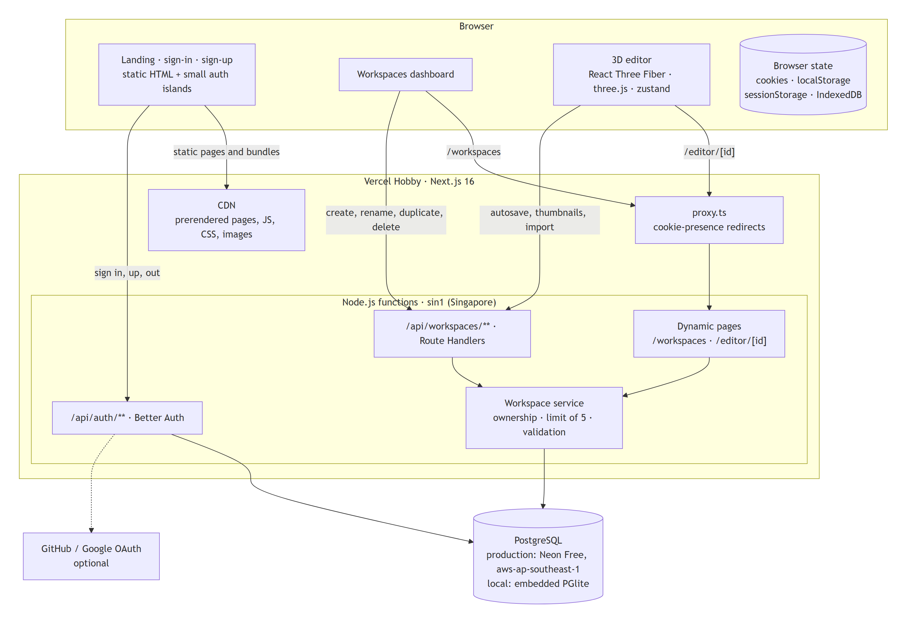

## 02 · Module dependencies

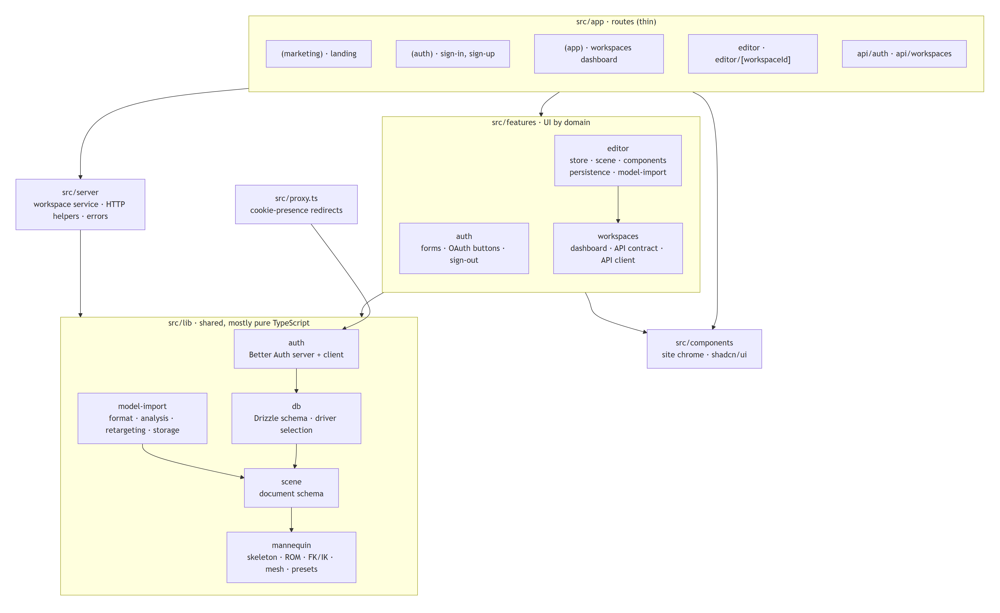

## 03 · Request routing

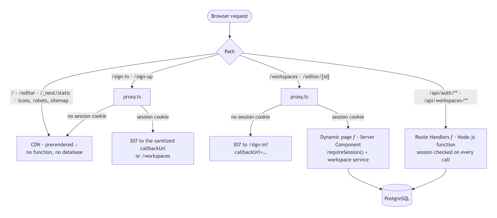

## 04 · Data model

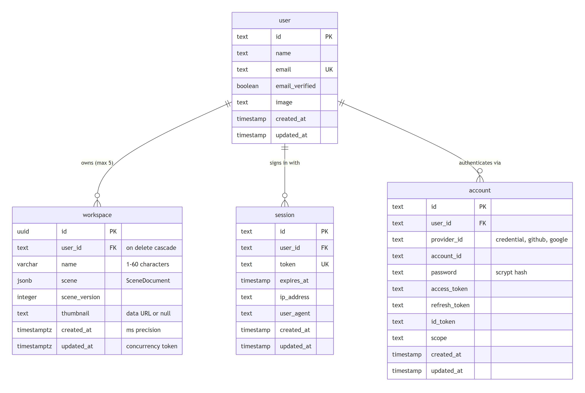

## 05 · Standalone auth tables

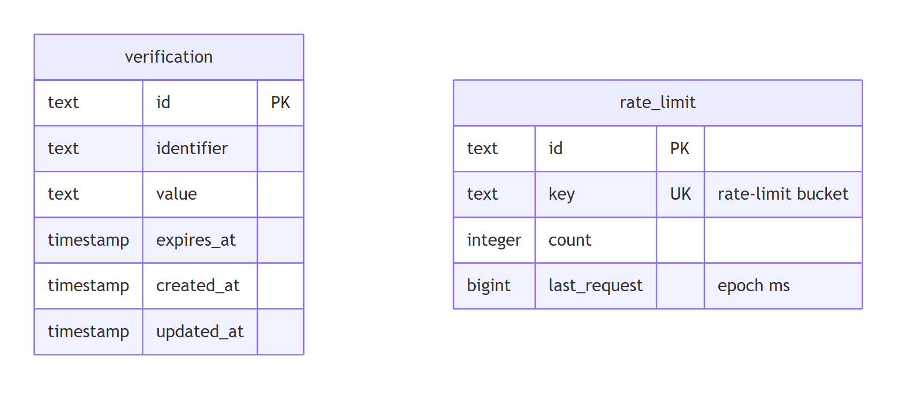

## 06 · Sign-in and session check

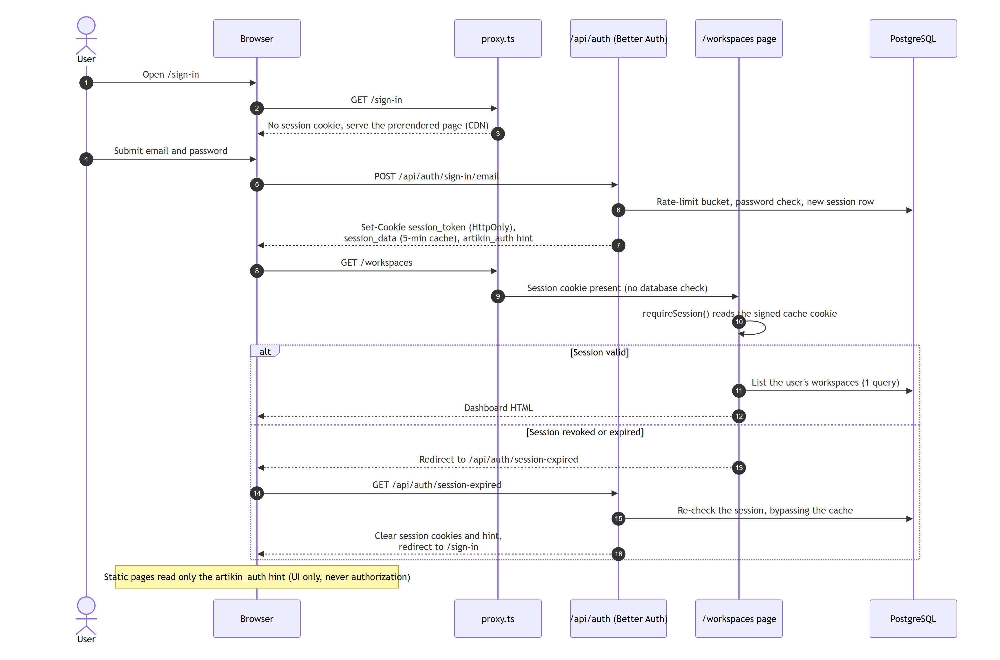

## 07 · Editor architecture

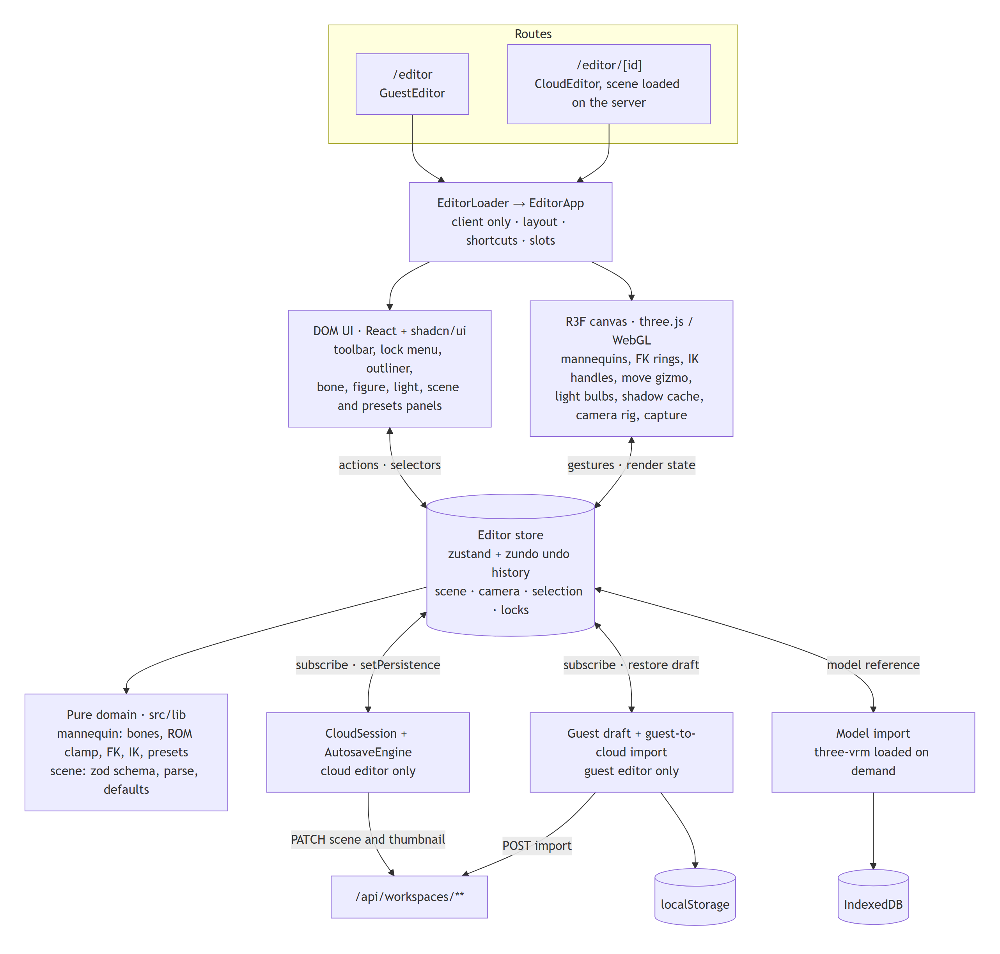

## 08 · Editor interaction states

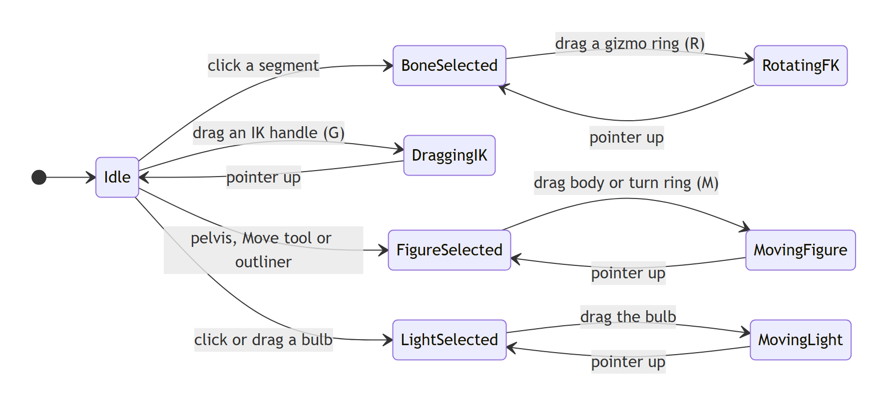

## 09 · Importing your own model

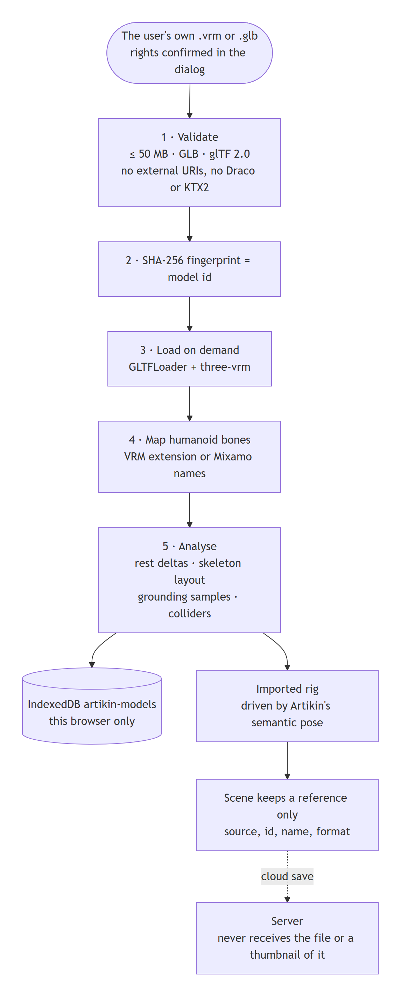

## 10 · Cloud autosave and conflicts

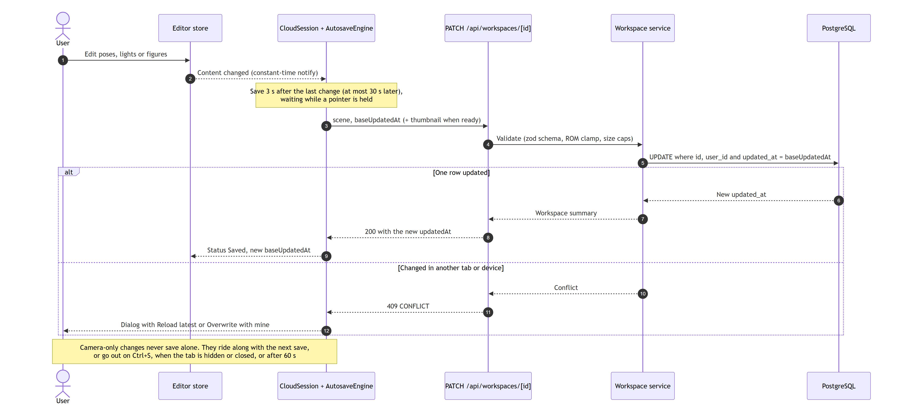

## 11 · Build and deployment

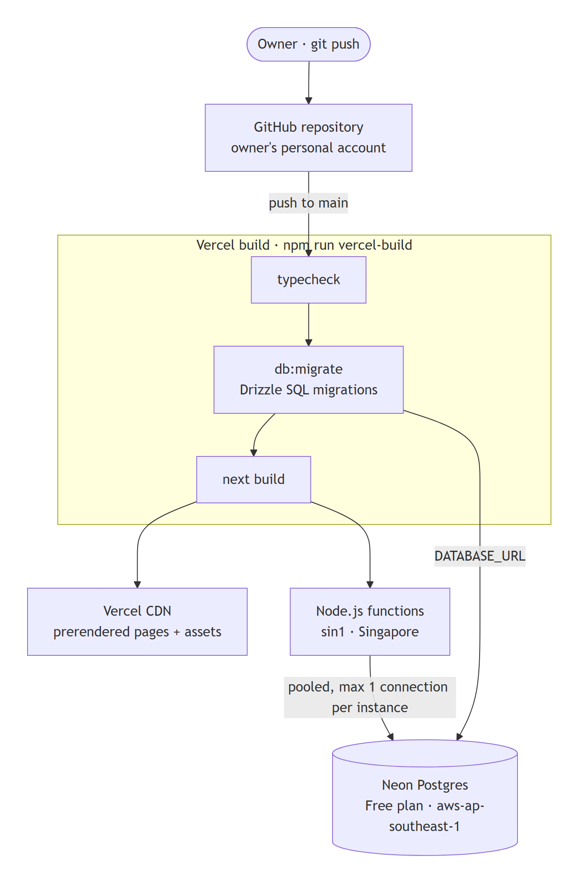
